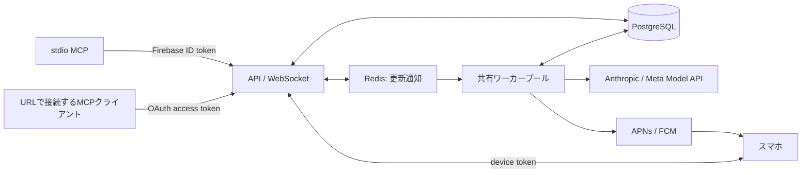

# クラウド版 お呼び出し

Railway上でAPIと会話ワーカーを別サービスとして実行する構成です。ローカルLAN版の`relay/`も引き続き利用できます。スマホは従来のペアリングを使います。MCPの接続方法は2つあります。URLを登録してブラウザでログインする[リモートMCP](#urlだけで接続するmcp)と、Firebase Authenticationへ接続するstdioブリッジです。stdioブリッジは匿名で開始し、あとからGoogleなどを同じUIDへリンクして復旧可能にします。公開環境のメインURLは[api.oyobidashi.me](https://api.oyobidashi.me)です。既存の[oyobidashi.up.railway.app](https://oyobidashi.up.railway.app)も同じAPIへ接続できます。



## 実行と設定

必要: Bun 1.4以降、PostgreSQL 17以降、Redis 7以降、利用者自身のFirebaseプロジェクト。Firebase AuthのAnonymousログインを有効にします。匿名UIDで継続利用するため、匿名アカウントの自動クリーンアップは有効にしないでください。API・workerの起動はFirebaseプロジェクト等を自動作成しません。CLIの初回ログインでは匿名ユーザーを作成します。以下の環境変数を設定してから実行してください。

```sh
bun install --cwd cloud --frozen-lockfile
bun run --cwd cloud build:auth
bun run --cwd cloud migrate
bun run --cwd cloud api
# 別のプロセスで実行
bun run --cwd cloud worker
```

共有設定は両プロセスへ、認証ページ・リンク署名器はAPIへ、会話API・Push送信の設定はworkerへ渡します。秘密情報をコマンド引数・git・ログへ載せないでください。

| 変数 | 用途 |
|---|---|
| `DATABASE_URL` | 共有PostgreSQL接続先 |
| `REDIS_URL` | 共有Redis接続先。障害中もDBから復旧 |
| `FIREBASE_PROJECT_ID` | 検証するFirebaseプロジェクトID |
| `FIREBASE_WEB_API_KEY` | APIが返すFirebase公開設定。匿名開始・ブラウザ認証に使うWeb APIキー |
| `FIREBASE_AUTH_PROVIDERS` | APIが表示する復旧プロバイダー。カンマ区切りの`google,apple,github`、既定`google`。Firebase側で有効化済みのものだけ指定 |
| `FIREBASE_AUTH_SERVICE_ACCOUNT_JSON` | API専用のアカウントリンク署名器。自分のFirebaseプロジェクトのサービスアカウントJSONを保護された秘密変数へ保存 |
| `PUBLIC_URL` | APIとworker共通の正規HTTPS origin。公式環境は`https://api.oyobidashi.me`、セルフホストでは自身のURLを設定。Pushを使うworkerには必須 |
| `OPENAI_APPS_CHALLENGE` | OpenAIのプラグイン審査で発行されたドメイン検証値。設定すると公式APIの `/.well-known/openai-apps-challenge` が値をそのまま返す |
| `MCP_REVIEW_FIREBASE` | 公式API専用。通常とは別のFirebaseプロジェクトの `projectId`、Webの `apiKey`、審査用の `uid` を含むJSON。審査アカウントのメールアドレスとパスワードは含めない |
| `PORT` | 待受ポート。既定8787、Railwayは自動設定 |
| `DB_POOL_SIZE` | 1プロセスのDB接続上限。既定10 |
| `TURN_CONCURRENCY` | 1ワーカーの同時LLM処理上限。既定8 |
| `PUSH_CONCURRENCY` | LLMとは独立したPush同時実行上限。既定4 |
| `MAX_SOCKETS` | 1APIのWebSocket／回答待ち上限。既定10000。実測の収容数ではありません |
| `ANTHROPIC_API_KEY`, `ANTHROPIC_MODEL` | Anthropicの会話判断。キーはworkerに、モデル名はAPIとworkerに設定 |
| `FREE_AI_PROVIDER`, `PLUS_AI_PROVIDER` | プランの提供元を `meta`、`gemini`、`claude` から選ぶ。APIとworkerに同じ値を設定 |
| `META_API_KEY`, `GEMINI_API_KEY`, `ANTHROPIC_API_KEY` | 選んだモデルのAPI認証。workerにのみ設定。Gemini APIキーには有料プロジェクトを使用 |
| `GOOGLE_SERVICE_ACCOUNT_JSON` | GeminiをVertex AI経由で使う場合のworker専用の秘密変数。JSONのプロジェクトで推論する |
| `VOICE_REQUIRE_DEVICE_PROOF` | APIとworker共通。セルフホストでApp Attest／Play Integrityを必須にする場合は`1`。公式環境では常に必須 |
| `VOICE_APPLE_TEAM_ID`, `VOICE_APPLE_BUNDLE_ID`, `VOICE_APP_ATTEST_ENVIRONMENTS` | API。クラウド音声のiOS端末証明。未設定時は`APPLE_TEAM_ID`、`APPLE_IAP_BUNDLE_ID`、`APPLE_APP_ATTEST_ENVIRONMENTS`を使う。課金の有効化は不要 |
| `VOICE_ANDROID_PACKAGE_NAME`, `VOICE_GOOGLE_SERVICE_ACCOUNT_JSON` | API。クラウド音声のAndroid端末証明。未設定時はGoogle Play課金の同名設定を使う。アプリ側にはPlay Integrity用Cloud Project Numberも必要 |
| `APPLE_IAP_PRODUCT_IDS`, `APPLE_IAP_BUNDLE_ID`, `APPLE_TEAM_ID` | API。App Storeの購読を受け付ける商品ID（カンマ区切り）、アプリのBundle ID、Team ID。商品IDが未設定ならAppleの課金は無効 |
| `APPLE_IAP_ENVIRONMENTS` | API。App Storeの取引環境。公式クラウドでは `Production` を設定し、Sandbox は下記の審査用 UID に限る |
| `APPLE_IAP_SANDBOX_REVIEW_UIDS` | 公式クラウドのAPIとworkerに同じ値を設定。Sandbox購入を許可する審査用Firebase UIDのカンマ区切り。空ならSandboxによるPLUSは付与されない |
| `PLUS_GRANT_UIDS` | APIとworkerに同じ値を設定。ストアでの購入なしにPLUSを付与するFirebase UIDのカンマ区切り（最大256件）。一覧にある間だけ有効で、外すとFREEに戻る。ストアの購読には影響しない |
| `APPLE_REVIEW_PORTAL` | 公式クラウドAPIに設定する任意のJSON。 `uid` はSandbox許可リストにある審査専用UID、`username` は審査用ログイン名、`passwordHash` はランダムに生成した十分長いパスワードのSHA-256（16進表記）。設定時に `/review/` を有効化 |
| `ANDROID_REVIEW_PORTAL` | 公式クラウドAPIの任意のJSON。 `uid` は `review-android-` に32桁のランダムな16進文字列を続けた審査専用ID、`username` は審査用ログイン名、`passwordHash` は長いランダムパスワードのSHA-256。設定時に `/review/android/` を有効化 |
| `APPLE_APP_ATTEST_ENVIRONMENTS` | API。受け付けるApp Attestの環境。公式クラウドでは `production` を設定。TestFlightとApp Storeでは本番の端末証明を使う |
| `GOOGLE_PLAY_PRODUCT_IDS`, `GOOGLE_PLAY_PACKAGE_NAME`, `GOOGLE_PLAY_SERVICE_ACCOUNT_JSON` | API。Google Playの購読を受け付ける商品ID、アプリのパッケージ名、Play Developer APIとPlay Integrity APIを呼べるサービスアカウントJSON |
| `GOOGLE_PLAY_PUBSUB_AUDIENCE`, `GOOGLE_PLAY_PUBSUB_SERVICE_ACCOUNT` | API。リアルタイム デベロッパー通知のPub/Sub pushを認証するaudienceと、pushに使うサービスアカウントのメール。未設定ならGoogleのWebhookは拒否 |
| `FCM_SERVICE_ACCOUNT_JSON` または `FCM_SERVICE_ACCOUNT_PATH` | Railwayの秘密変数に設定するサービスアカウントJSON、または保護されたファイル。両方の指定は拒否 |
| `APNS_KEY_PEM` または `APNS_KEY_PATH` | Railwayの秘密変数に設定するAPNs鍵本文、または保護されたファイル。両方の指定は拒否 |
| `APNS_KEY_ID`, `APNS_TEAM_ID`, `APNS_BUNDLE_ID` | ワーカーのAPNs設定。利用者自身の値を使用。標準の本体Bundle IDは`me.oyobidashi.ios`。旧アプリからの移行時は、新アプリのインストール・再ペアリングと合わせて送信topicを切り替える |

会話APIが未設定ならテキスト・通知は使えますが、音声ターンは明示的な失敗となります。クラウドではClaude Code CLIのOAuthやサブスクリプション認証を共有しません。LAN版のCLI方式とは別の、APIの利用設定が必要です。

セルフホストでは、ペアリング済みの端末が自分の端末トークンで応答・発話できます。会話に使うLLM APIはworkerに設定し、バックグラウンドで着信させる場合はアプリのビルドに対応するPush設定も用意してください。

公式環境と、セルフホストで `VOICE_REQUIRE_DEVICE_PROOF=1` を指定した環境では、応答・発話に10分有効の音声トークンが必要です。iOSはApp Attest、AndroidはPlay Integrityで登録します。AndroidのIntegrity判定は登録時と6時間ごとの更新時に要求し、音声トークンの更新は端末内の署名鍵を使用します。端末証明を設定していないプラットフォームや音声トークンに未対応のアプリでは、これらの環境で通話できません。

音声発話はアカウントごとに直近60分で30件までです。通話や端末を変えても合算し、同じ発話の再送は重複計上しません。上限に達した後の発信はテキストで届き、通話中に次の発話が上限を超えた場合もテキストで返信できます。

異常利用による停止条件は、1分に異なる発話IDを30件、または5分に2000文字超の発話3件です。停止記録に期限や利用者向け解除APIはありません。Firebase UIDを新規作成できる状態では、新しいアカウントまで恒久的に阻止するものではありません。

FREEでMuse Ember Standard、PLUSでGemini 3.5 Flash-Liteを使う設定は、APIとworkerに`FREE_AI_PROVIDER=meta`と`PLUS_AI_PROVIDER=gemini`です。workerには`META_API_KEY`と、Gemini用の`GOOGLE_SERVICE_ACCOUNT_JSON`または`GEMINI_API_KEY`のどちらか一方を設定します。Vertex AIは課金とAPIを有効にし、サービスアカウントに`aiplatform.endpoints.predict`を付与します。モデル名と推論設定は提供元ごとにコードで選びます。通話に対応するアプリが送信先を確認してから設定を切り替えてください。[Vertex AIのアクセス制御](https://docs.cloud.google.com/gemini-enterprise-agent-platform/models/access-control)

過去にMetaプロバイダーを異なるリージョンから検証しました。Singaporeの当該workerからは`404 model_not_found`でしたが、同じキーで日本のMacからは成功しました。workerを米国西部へ移し、実際の会話判断・回答要約・お礼の取得に成功しています。送信元や配信経路による差と考えられますが、Singapore全体の利用可否を断定するものではありません。実iPhoneでも、クラウド経由の着信・音声認識・確認質問への再回答・お礼の読み上げ・自動終話を確認しました。[検証記録](../docs/VALIDATION.md)

2026-11-25の再検証では、同じ本番キーで米国西部・東部の通話モデルがHTTP 404を返し、Singaporeでは標準版とContributor版の通話モデルが応答しました。本番workerをSingaporeへ移し、複数の回答を一つの発話から保存して残りをテキストで完了する処理を検証しました。リージョンを変えた際は、モデル一覧とあわせて本番設定のモデルへの実際のリクエストを確認してください。

両方のプラン設定が空の場合は、既存の`VOICE_PROVIDER`、`VOICE_MODEL_FREE`と関連する設定で稼働します。既存の公式環境ではMetaのキーを`MODEL_API_KEY`から読み取れるため、切り替えの前後に認証の互換性を保てます。

### サブスクリプション

課金・購入の復元・自動同期は `https://api.oyobidashi.me` でのみ利用できます。公式APIでもストア商品を設定するまで課金は無効です。セルフホストと旧Railwayホストでは `GET /v1/billing` は `{"enabled":false}` を返します。セルフホストでは指定した標準モデルで通話でき、LLM APIやホスティングの費用は運営者が負担します。

公式環境では購読中の利用者に標準モデルを使い、未購読者には `VOICE_MODEL_FREE` が指定されていればそのモデルを使います。片方が失敗しても、もう片方へは切り替えません。アプリとMCPは設定された学習利用条件を参照し、モデル名は表示しません。学習利用の設定値はプロバイダーとの契約・設定に合わせて指定してください。

- 購入の登録は端末認証に加えて、iOSはApp Attest、AndroidはPlay Integrityの検証を通った端末だけが呼べます。開発ビルドはApp Attestがdevelopment、Playを経由しないAndroidビルドは検証に通りません。
- Appleの購読は、本人の購入のほか、ファミリー共有と、組織がApple Business／Apple School Managerでまとめて購入して割り当てた席も受け付けます。割り当てた席は端末での購入を伴わないので、アプリは起動時とストアの更新時にも同期します。
- 更新・解約・返金・席の取り消しはストアの通知で反映します。App Store Connectの「App Store サーバ通知」(Version 2) に`<PUBLIC_URL>/v1/billing/webhooks/apple`を、Google PlayのPub/Sub pushに`<PUBLIC_URL>/v1/billing/webhooks/google`を設定します。
- ストアとの契約は[プロトコル](../docs/CLOUD_PROTOCOL.md)を参照してください。ローカルでは `./scripts/test-cloud.sh` で隔離DBを使う課金テストを実行できます。

ローカルスタックの例はルートの`compose.cloud.yml`です。`.env`はgit管理外です。`docker compose -f compose.cloud.yml up --build`で起動します。実Firebaseログイン・API利用・Push送信には自身の設定が必要です。

## Railway

新しいRailwayサービスは旧`railway.toml`を読みません。[Infrastructure as Code](https://docs.railway.com/infrastructure-as-code)を使う`cloud/.railway/railway.ts`を用意しています。API・worker・Postgres・Redisと永続Volumeの構成を定義し、変数は`managed: false`としてRailway側で管理します。コードの適用で手動設定したAPIキーを削除しません。

```sh
bun install --cwd cloud --frozen-lockfile
cd cloud
# 利用者自身のプロジェクト・production環境へリンクしてから差分を確認
railway link
railway config plan
# 差分に意図しない削除がないことを確認して適用
railway config apply
```

Railway CLIは5.74.0で検証しています。本番へ設定を適用する前に、`railway config plan` で対象のサービスと変更項目を確認します。設定はSingaporeのAPI 1台・worker 1台を初期値とし、DB/RedisもSingaporeです。アカウントの既存プロジェクトを確認し、重複作成しないでください。

公式環境の `api` と `worker` は GitHub の `YusukeIwaki/oyobidashi` の `main` から自動デプロイします。`Dockerfile.cloud` が取り込むクラウド・MCP・relay のソース、依存関係やDockerのビルド設定を更新すると、両サービスが再ビルドされます。反映は、リンク済みの `cloud/` で `railway deployment list --service api` と `railway deployment list --service worker` を実行して確認します。

セルフホストでフォークから自動デプロイする場合は、定義のGitHubリポジトリを変更してください。手元からデプロイする場合は、リンク済みプロジェクトを確認し、リポジトリルートから `railway up --service api` と `railway up --service worker` を実行します。

APIだけに公開ドメインを割り当て、HTTPSで利用します。ワーカー・PostgreSQL・Redisはプライベートネットワークで接続します。どちらのアプリサービスにもVolumeは不要です。イメージは`Dockerfile.cloud`で作成し、`.dockerignore`の許可リストで資格情報・端末ログ・ネイティブソースを除外します。

最初はAPI 1台、ワーカー1台で開始できます。APIとワーカーは別々にレプリカを増やせます。DB/Redisの冗長化・バックアップ・接続総数は別に設計します。サービス数を増やすだけでDBが高可用になるわけではありません。全レプリカの`DB_POOL_SIZE`合計をDBの接続上限以下にし、必要に応じて接続プーラーを使います。

ワーカー増減の基準は登録人数ではなく、最も古いreadyジョブの待ち時間、同時LLM処理数、APIレート制限です。CPUだけで判断すると外部API待ちを検出できません。自動レプリカ増減のコントローラーは含みません。まず待ち時間を計測し、手動で調整してください。

`/healthz`はプロセスの生存と機能を返し、`/readyz`はDB接続まで確認します。Redis停止はreadinessを落としません。SIGTERM時は新規処理を止め、端末を再接続させ、進行中ジョブを返却します。SIGKILLなら15秒のリース切れで別ワーカーが引き継ぎます。

## URLだけで接続するMCP

公式クラウドを Claude Code・Codex で使う場合は、[配布プラグイン](../plugins/oyobidashi/README.md)からも接続できます。

MCPクライアントに`https://<APIのホスト>/v1/mcp`を登録します。公開環境では次のとおりです。

```sh
claude mcp add -s user --transport http oyobidashi https://api.oyobidashi.me/v1/mcp
```

`-s user`を付けると、自分のどのプロジェクトからでも使えます。省略すると現在のプロジェクトだけに登録され、別のプロジェクトでは登録し直すことになります。

初回の接続でブラウザが開きます。Google・Apple・GitHubのいずれかでログインし、接続先を確認して明示的に許可します。スマホの登録は、公式クラウドならお呼び出しアプリの「Oyobidashiクラウドに接続」を押し、同じアカウントでログインして「アプリを開く」を押します。スマホが未登録なら同じ画面にQRコードも出るので、アプリの「自分で用意したサーバーに接続」→「QRコードを読み取る」でも登録できます。自分で配備したクラウドではこちらを使います。接続済みアプリの確認・取消しは`https://<APIのホスト>/oauth/connections`で行えます。最後のスマホをペアリング解除すると、そのアカウントのMCP許可も失効します。あとからスマホを追加するときは`https://<APIのホスト>/pair`を開きます（公式クラウドはアプリの「Oyobidashiクラウドに接続」が、このページをスマホで開きます）。アプリから開いた場合はQRコードの代わりに「アプリを開く」が先頭に出ます。アプリは自分で開いたページからのリンクだけを受け付けるので、スマホのブラウザで直接開いた場合は、アプリから始めるよう案内します。以後、`login-cloud.sh`や`pair-cloud.sh`は不要です。

stdioブリッジで外部アカウントをリンク済みなら、同じアカウントでログインすると同じ利用者になり、登録済みのスマホをそのまま使えます。匿名のままのアカウントではリモートMCPを使えません。先に`--link`でアカウントを登録してください。

APIがOAuth 2.1の認可サーバーを兼ねます。追加の環境変数はなく、`FIREBASE_WEB_API_KEY`があれば有効になります。発行元のURLはクライアントが接続したホストから決まり、`PUBLIC_URL`と同じホストならその値を使います。

- クライアントは事前登録なしで接続します（動的クライアント登録）。クライアントシークレットはなく、PKCEが必須です。
- アクセストークンは1時間、リフレッシュトークンは最後の利用から180日有効です。どちらもハッシュだけを`cloud_oauth`テーブルへ保存します。
- これらのトークンで使えるのは`/v1/mcp`だけです。ペアリングコードの発行やアカウントのリンクには使えません。
- 1回の呼び出しで待てるのは最長300秒です。`ask_human`が`pending`を返したら`wait_for_answer`を繰り返します。
- `human://status`の購読は使えません。`get_human_status`で読み取ります。

ローカル実行時は`bun run --cwd cloud build:auth`で同意画面のbundle（`public/oauth.js`）も生成します。エンドポイントと検証内容の詳細は[docs/CLOUD_PROTOCOL.md](../docs/CLOUD_PROTOCOL.md#hosted-mcp-endpoint)を参照してください。

## Claude の請求先連携（公式クラウド）

1. 管理者は `api.oyobidashi.me/oauth/connections` で既存の Oyobidashi アカウントにログインし、組織を作ります。Claude 側で Admin または Billing 権限を持つ管理者が、その Oyobidashi 組織に Claude Console の組織を連携します。
2. 管理者は招待する人のメールアドレスを指定し、発行された招待コードを本人に渡します。コードは単回使用で、3日間有効です。招待された人は既存の Oyobidashi アカウントで同じページにログインし、コードを入力します。Firebase の確認済みメールアドレスが招待と一致していれば、端末をペアリングし直さずに利用できます。
3. Claude API の利用分は Anthropic が連携先の組織に直接請求します。Oyobidashi の PLUS 購入は不要です。Claude Pro / Max などの契約枠は対象外です。

Oyobidashi の組織ごとに Claude の請求用プロファイルを1件持ち、利用者の Firebase UID から所属を確認します。アカウントが参加できる請求先組織は同時に1つです。管理者はメンバーを外せます。メンバーは自分で退出できます。管理者の Oyobidashi アカウントを削除すると、管理していた組織の連携とメンバー登録も解除します。

連携が有効な間は、通話の文字起こしと質問・補足・選択肢・会話履歴を Anthropic へ送ります。Claude の連携切れ、利用上限、所属変更で処理できない場合は、同じ質問に文字で返信できます。過去の Claude 用の質問を、別の組織や標準の音声モデルで再利用することはありません。

組織の連携ごとに発行された OAuth トークンで Claude を呼び出します。アクセストークンとリフレッシュトークンは、署名鍵とは別の Cloud KMS 鍵で暗号化し、PostgreSQL の `cloud_claude_tokens` に保存します。暗号文は Oyobidashi の組織 ID と Anthropic の連携 ID に結びつきます。

同じ組織の更新は PostgreSQL で直列化します。更新結果が不明なときは旧トークンを再送せず、管理者による再連携まで通話を文字返信に切り替えます。以前の共通トークン方式で連携した組織も再連携が必要です。DB を過去のバックアップから復元する場合は、連携機能を停止した状態で復元し、再連携してください。復元した古いリフレッシュトークンを使うと Anthropic が連携を失効させる場合があります。

### Claude Console の設定

1. Google Cloud KMS に署名用の鍵を作ります。アルゴリズムは `RSA_SIGN_PKCS1_2048_SHA256`、`RSA_SIGN_PKCS1_3072_SHA256`、`RSA_SIGN_PKCS1_4096_SHA256` のいずれかです。HSM 保護レベルも選べます。API と worker に別々の専用 Google サービスアカウントを用意し、その鍵にだけ `cloudkms.cryptoKeyVersions.useToSign` と `cloudkms.cryptoKeyVersions.viewPublicKey` を許可します。`CLAUDE_BILLING_KMS_KEY_VERSION` に鍵バージョンのリソース名を設定します。署名の秘密鍵は KMS に保持されます。アプリの設定前に、API の公開 JWKS を確認できます。
2. Claude Console の Workload identity で Custom OIDC を登録します。issuer は `https://api.oyobidashi.me/claude-identity`、JWKS は `https://api.oyobidashi.me/claude-identity/jwks` です。
3. OAuth apps で **Bill and link to organizations** を有効にした OAuth アプリを作り、`billing:attribution` と `offline_access` を許可します。戻り先は `https://api.oyobidashi.me/oauth/claude/callback` です。Client authentication のサブジェクトは `oyobidashi:claude:client` に絞ります。
4. オペレーター用のサービスアカウントと Workload Identity Federation ルールを作ります。ルールのサブジェクトは `oyobidashi:claude:operator` に絞り、Client authentication とは別の audience を使います。OAuth アプリでオペレーターとデフォルトのワークスペースを指定し、**Disable operator-only tokenless authentication** を有効にします。共通トークンはユーザープロファイルの管理に使います。
5. API と worker に同じ `CLAUDE_BILLING_CONFIG`（JSON）を設定します。KMS に別の対称鍵（`ENCRYPT_DECRYPT`）を作成し、その CryptoKey のリソース名を両方の `CLAUDE_BILLING_KMS_TOKEN_KEY` に設定します。API のサービスアカウントにはこの鍵の暗号化だけを、worker のサービスアカウントには暗号化と復号を許可します。Railway では各サービス固有の Google サービスアカウントの JSON 鍵を `CLAUDE_BILLING_GOOGLE_SERVICE_ACCOUNT` に設定してシールします。アプリはこの鍵を使って Cloud KMS スコープの短命トークンを取得します。Google Cloud 上で実行する場合はこの環境変数を省略し、実行環境に割り当てたサービスアカウントを使用します。API と worker の両方で対応版を配備してから有効にします。

```json
{
  "clientId": "<OAuth app client ID>",
  "clientAudience": "<OAuth client audience>",
  "operatorAudience": "<WIF audience>",
  "organizationId": "<operator organization ID>",
  "federationRuleId": "<WIF rule ID>",
  "serviceAccountId": "<operator service account ID>",
  "workspaceId": "<workspace ID>",
  "model": "<Claude API model ID>"
}
```

6. アプリの Test users に、別の API 課金組織の Admin または Billing 担当者を追加します。管理者が連携した組織にテスト利用者を招待します。テスト利用者が更新済みのモバイルアプリで通話に応答し、Claude Console で組織ごとの請求先を確認します。一般公開には [Anthropic の公開手続き](https://platform.claude.com/docs/en/manage-claude/oauth-apps/app-review) が必要です。

Anthropic の設定とテスト条件は [Linked billing の公式手順](https://platform.claude.com/docs/en/manage-claude/oauth-apps/organization-billing-connections) に従います。


## ログインとペアリング

以下はstdioブリッジを使う場合の手順です。


リポジトリルートから、対話デスクトップ端末で実行します。公開環境を使う場合、Firebase公開設定はAPIから取得するので`--api-key`不要です。自分の環境ではURLを自分のHTTPS originへ置き換えてください。

```sh
bun install --cwd mcp --frozen-lockfile
./scripts/login-cloud.sh --url https://api.oyobidashi.me
./scripts/pair-cloud.sh
# 現在の匿名UIDを保ったままGoogleを復旧用に登録
./scripts/login-cloud.sh --url https://api.oyobidashi.me --link google
# 以前リンクしたGoogleアカウントのUIDへ戻す場合
./scripts/login-cloud.sh --url https://api.oyobidashi.me --recover google
```

既定のログインは匿名です。保存済み資格情報があれば同じUIDを再利用し、質問・スマホのペアリングを保持します。`--link google`はそのUIDへGoogleを追加します。別UIDに登録済みの認証情報をリンクしようとすると拒否し、復旧ログインを案内します。

既存の資格情報に旧URLが保存されている場合は、ログイン・`--link`・`--recover`にも保存済みの旧URLを指定します。ログイン補助は別の接続先による資格情報の上書きを拒否します。旧URLも引き続き利用できるため、ドメイン追加に伴う再ペアリングは不要です。

`--recover google`は明示的な復旧です。既存の別UIDの資格情報があれば、`cloud-auth.json.before-recovery-<時刻>-<UUID>.json`へ権限600でバックアップしてから、復旧先の資格情報を保存します。ファイルがない場合や同UIDの場合は別UID用バックアップを作りません。別UID間の質問やペアリングを統合する処理ではありません。

**外部アカウントをリンクせず、匿名アカウントの資格情報を失うと復旧できません。** 新しい匿名UIDを作っても元の質問・ペアリングは戻りません。匿名アカウントの自動クリーンアップも有効にしないでください。

現在の公開環境はGoogle・Apple・GitHubをFirebaseで設定済みです。旧URLでは3つとも既存UIDへのリンクと、保存済み資格情報を使わない独立した再ログインでも同じUID・端末一覧を取得できることを実ブラウザで確認しました。新しいメインURLではGoogleの再ログイン・同じUIDと端末一覧の取得を確認し、Apple・GitHubのコールバック設定は維持しています。既存のペアリングを復旧用アカウントへ関連付けるときは、`--link apple`・`--link github`を使います。[各プロバイダーと独自ドメインの検証記録](../docs/VALIDATION.md)

補助スクリプトは既存の`scripts/mcp.sh`と同じ状態ディレクトリ（既定はリポジトリの`.oyobidashi/`）を使います。資格情報と復旧バックアップは権限600で保存し、既存のLAN設定・他サービスの認証を変更しません。MCP設定はstdio起動のままです。直接`bun run --cwd mcp login:cloud`を使う場合の既定保存先は`~/.oyobidashi/`なので、`OYOBIDASHI_HOME`を揃えてください。詳細は[mcp/README.md](../mcp/README.md#クラウドへの接続)を参照してください。

## Firebaseの認証設定と署名器

Firebase AuthenticationでAnonymousと利用する復旧プロバイダーを有効にし、認証の承認済みドメインへAPIの公開ホストを登録します。現在の公開環境では`api.oyobidashi.me`と`oyobidashi.up.railway.app`の両方を登録します。ブラウザのFirebase `authDomain`は`FIREBASE_PROJECT_ID.firebaseapp.com`を使います。APIのカスタムドメイン追加ではこの値を変えず、各プロバイダーのコールバックURLも`https://<project-id>.firebaseapp.com/__/auth/handler`を維持します。両APIドメインは同じサービスへ直接接続し、認証中に別のAPIドメインへリダイレクトしません。`FIREBASE_AUTH_PROVIDERS`へ名前を追加するだけではGoogle・Apple・GitHubのプロバイダー設定は完了しません。

利用者のメールアドレスなどの認証属性はFirebase標準の管理に従います。アプリのPostgreSQLへ認証属性のメールアドレス・プロフィール・照合用のメールハッシュをコピーせず、検証済みのFirebase UIDで認可します。認証トークンにはFirebaseの属性が含まれる場合があり、MCPの資格情報ファイルはトークンを権限600で保護します。メールアドレスを認証ログやMCPの認証検査結果へ出しません。

### Apple・GitHubのプロバイダー設定

GitHubは利用者のアカウントでOAuth Appを登録し、Firebaseが表示する`https://<project-id>.firebaseapp.com/__/auth/handler`をコールバックURLへ設定します。Client ID・Client SecretはFirebase AuthenticationのGitHub設定へ保存します。ワイルドカード・Device Flowや追加のリポジトリ権限は、このログインには不要です。[FirebaseのGitHub手順](https://firebase.google.com/docs/auth/web/github-auth)

Appleは利用者の開発チームで本体App IDのSign in with Appleを有効にし、Web用Services IDを作成します。Primary App IDへ関連付け、Firebaseの認証ドメインと上記コールバックURLを登録します。そのApp IDに関連付けたSign in with Apple専用鍵を発行し、Services ID・Team ID・Key ID・秘密鍵をFirebaseのApple設定へ保存します。秘密鍵は一度しかダウンロードできないため、権限600のgit管理外ファイルで保護します。既存APNs鍵は変更しません。[FirebaseのApple手順](https://firebase.google.com/docs/auth/web/apple)

各プロバイダーをFirebase側で有効にしてから、APIの`FIREBASE_AUTH_PROVIDERS=google,apple,github`へ反映して再デプロイします。OAuthのClient SecretやAppleの秘密鍵をRailway・ブラウザbundle・MCPへ複製する必要はありません。Appleのメール非公開も利用でき、復旧先はメール文字列ではなく同じFirebase UIDで照合します。

`FIREBASE_WEB_API_KEY`は公開設定です。`FIREBASE_AUTH_SERVICE_ACCOUNT_JSON`は現在のUIDへ復旧用プロバイダーをリンクするための秘密の署名器で、APIサービスだけへ設定します。JSONのプロジェクトID・サービスアカウントのメール・秘密鍵を検査し、異なるプロジェクトや不正な鍵なら起動を拒否します。通知送信用の`FCM_SERVICE_ACCOUNT_JSON`とは別用途で、暗黙には流用しません。署名鍵をブラウザbundle・端末・MCP設定へ埋め込んだり、チャット・git・ログへ出したりしないでください。

| エンドポイント | 用途・認可 |
|---|---|
| `GET /v1/auth/config` | Firebase公開設定、設定済みプロバイダー、`canLinkExisting`を返す |
| `GET /auth`、`GET /auth.js` | CLIから開始するブラウザ認証ページとbundle |
| `POST /v1/auth/link-token` | 本人のFirebase IDトークンで認証したagentのみ。空オブジェクトを受け、本人UID専用・5分有効のカスタムトークンを返す。別UIDの指定は拒否、1人10回/分まで |

公開設定がなければ認証ページは503、署名器がなければ`canLinkExisting:false`となり、リンク用トークンの発行も503です。匿名UIDを復旧可能にする運用では、公開設定と署名器を両方準備してください。ローカル実行時は`bun run --cwd cloud build:auth`でbundleを作り、Dockerイメージではbuild段階に生成して実行イメージへコピーします。

ブラウザではFirebaseのメモリ内セッションを使い、保存済みの別アカウントへ自動接続しません。リンク時は元のUIDと一致することをカスタムトークン認証後・プロバイダー連携後・資格情報取得後に確認します。ハンドオフのfragmentは読み取り直後に消去し、IDトークン・refresh tokenを一度限りのループバックへPOSTします。MCP側もHost・Origin・state・UIDを検証します。ポップアップの取り消しや失敗で元の資格情報を置き換えません。

ここまではFirebaseを利用する専用stdioブリッジの説明です。URLだけで接続するクライアント向けの認可は[URLだけで接続するMCP](#urlだけで接続するmcp)を参照してください。APIはIDトークンの署名・発行元・プロジェクト・期限・UIDを検証します。Firebase側でログインを取り消した既発行トークンの即時失効照会は行わないため、IDトークンの有効期限までの窓があります。

## 障害とUXの契約

| 状況 | サーバー／アプリの動作 |
|---|---|
| 人間が無言・読み上げ中 | DBに通話状態があるだけ。会話ジョブ・専用コンテナ・DBロックを保持しない |
| 発話を受理 | 発話とジョブを同一トランザクションで保存し202。端末は待機中表示 |
| POSTの応答だけ消失 | 同じ発話IDをGETで回収。対応確認済みのクラウドにのみ同じIDを再送 |
| 旧LANサーバーとの通信断 | 危険な自動再送をせず、認識テキストを残す |
| ワーカーが強制終了 | リース切れで再取得。古い実行結果はフェンシングで拒否 |
| LLMの429・5xx・通信断 | 最大3試行、発話受付から90秒以内。認証エラー・壊れた出力は再試行しない |
| 端末が通信断・アプリ終了 | 発話IDと認識テキストを端末に保存。再接続・明示的再試行で取得 |
| 回答・取り消し・終話・期限切れが競合 | DBで直列化。終端状態を遅いLLM結果で上書きしない |
| 最終音声応答が確定 | お礼を読み終えてから終話。WebSocket更新で読み上げを切らない |
| Redisの停止・通知消失 | DBのジョブ取得を継続。APIは変更番号をまとめて照会して補完 |
| 通知履歴が増える | 未回答を別クエリで取得し、再接続の一覧から落とさない |
| 遅いWebSocket | バッファ上限で切断。再接続時に正本のスナップショットを取得 |
| アカウント切り替え | Push宛先を全ユーザーで一意所有。旧宛先IDの端末イベントを破棄 |
| 通知を受けたアプリが休止中 | Cloud Pushは本文を汎用化。iOS拡張は短命・質問限定のプレビュートークンで本文と選択肢を取得。取得できなければ汎用通知からアプリを開く |
| 着信拒否・45秒無応答・10分無言 | 質問を残してテキストへ切り替え。自動再発信しない |
| 過負荷 | 1人の未回答200件、保存済みリクエスト1000件、端末32台、質問／発話60回/分、一方向通知10件/分、ペアコード20回/分、同時WebSocket・長時間待機8本を上限に429。通話履歴は直近8発話に制限 |

端末側の全体待ち時間は95秒、ポーリングは250msから2秒までのバックオフです。待機中は非同期タスク／コルーチンが停止し、スレッドを占有しません。明示的に失敗した発話は新しいIDで再試行できます。結果不明の発話は同じIDで回復します。

端末通信断でコミット済みジョブは取り消しません。モデル呼び出しとPushはクラッシュの境界で重複する可能性があり、外部サービスへのexactly-onceは保証しません。本文・回答を成功扱いするのはDB確定後だけです。再起動後もジョブの正本はPostgreSQLに残ります。終了済み質問・発話は30日、在席フィードバックは7日、完了ジョブは1日を目安に掃除します。

## 検証

```sh
bun run --cwd cloud typecheck
bun test --cwd cloud
# 実PostgreSQL／Redisの強制断・復旧試験を含む。専用コンテナを作り終了時に削除
./scripts/test-cloud.sh
```

通常の`bun test`では実DB／Redis試験だけをskipします。CIは隔離した両サービスを起動して全件実行します。試験には実ワーカープロセスのSIGKILL、DBバックエンド接続の強制終了、Redis購読TCP切断、実WebSocket再接続、HTTP本文途中切断を含みます。1000人の無言セッション・変更のない接続の一括確認・変更時の最大並列数も構造として検証します。これらはCPU別の同時収容数の実測ではありません。

実Firebase、Railway、APNs/FCM、端末の音声は別の実測です。ローカルの障害注入試験を、それらの接続成功の代用にはしません。

### iOS 1.0.0 の公開時に合わせる設定

- API の `FIREBASE_AUTH_SERVICE_ACCOUNT_JSON` のサービスアカウントには、対象プロジェクトの `firebaseauth.users.get` と `firebaseauth.users.delete` が必要です。Apple でサインインした利用者については、Firebase 側の Apple プロバイダーにサービス ID と OAuth コードフローの設定も必要です。
- FREEプランの入力制限は、API とワーカーの `VOICE_MODEL_FREE` と `VOICE_FREE_TRAINING` から決まります。両サービスの設定を揃えます。公式クラウドで FREE 用の別モデルを使い、`VOICE_FREE_TRAINING` が `0` でない場合に限り、FREE の利用者へ「個人情報・機密情報を送らない」ことへの同意を求めます。同意はエージェントの連携時（`/oauth/authorize` の画面、または `login:cloud`）に1回だけ行い、通話中には何も確認しません。PLUS の利用者とセルフホストには制限も同意もありません。詳細は[docs/CLOUD_PROTOCOL.md](../docs/CLOUD_PROTOCOL.md#free-plan-input-restriction)を参照してください。
- 同意前の FREE 利用者には音声通話を発信せず、質問は文字で届きます。同意は `/oauth/connections` にログインして行えます。

### Apple課金の本番と審査用Sandbox

公式クラウドは、審査用UIDの購入時に設定された `appAccountToken` が一致するSandbox取引だけを受け付けます。審査用端末は専用アカウントから発行したペアリングコードで接続します。審査が終わったらAPIとworkerの許可リストからそのUIDを外すと、審査用購読によるPLUSの利用も終了します。TestFlightのStoreKit購入はSandboxで、音声と課金のApp Attestには `production` を使います。

App Review の審査メモに公式APIの `/review/` へのリンクを記載し、ログイン名とパスワードは App Review のサインイン情報欄に入力します。審査担当者はポータルで発行したQRコードをアプリ内で読み取るか、同じ画面のURLとコードをアプリ内で手入力して1台のiPhoneをペアリングし、テスト着信を送れます。普段のアカウントとは別の審査専用UIDで運用します。審査後は `APPLE_REVIEW_PORTAL` を外します。

Google Playの審査担当者には「ログインの詳細」で公式APIの `/review/android/` とAndroid専用のログイン情報を案内します。担当者はここでAndroid端末1台をペアリングし、テスト質問と音声着信を試せます。通常のアカウントやiOS審査のアカウントから独立しています。審査画面のボタンから購入なしで2時間だけPLUS音声を試せます。FREEへの切り替えまたは端末の切断で試用が終了します。審査環境が不要になったら `ANDROID_REVIEW_PORTAL` を外します。

審査用UIDがFREEの入力制限の対象なら、ポータルで審査担当者本人が制限に同意してからテスト着信を送れます。アプリではペアリング時に、会話データの第三者AIへの送信について別に同意します。

App Store Connectの「アプリ情報」にApp Storeサーバ通知のVersion 2として以下を登録します。APIは通知と取引の署名を検証し、受信先の環境と一致する取引だけで権利を更新します。

- 本番 `https://api.oyobidashi.me/v1/billing/webhooks/apple/production`
- Sandbox `https://api.oyobidashi.me/v1/billing/webhooks/apple/sandbox`
- App Store Connect のプライバシーポリシー URL は `https://ai.oyobidashi.me/privacy/` です。製品サイトを公開した後、URL がログインなしで開けることを確認します。
