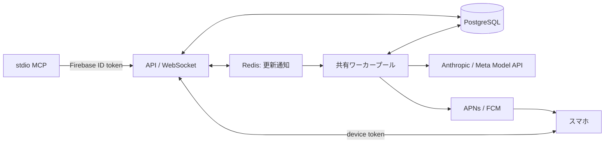

# クラウド版 お呼び出し

Railway上でAPIと会話ワーカーを別サービスとして実行する構成です。ローカルLAN版の`relay/`も引き続き利用できます。スマホは従来のペアリングを使い、MCPはFirebase Authenticationへ接続するstdioブリッジを使います。既定は匿名で開始し、あとからGoogleなどを同じUIDへリンクして復旧可能にします。公開環境のメインURLは[api.oyobidashi.me](https://api.oyobidashi.me)です。既存の[oyobidashi.up.railway.app](https://oyobidashi.up.railway.app)も同じAPIへ接続できます。



## 実行と設定

必要: Bun 1.4以降、PostgreSQL 17以降、Redis 7以降、利用者自身のFirebaseプロジェクト。Firebase AuthのAnonymousログインを有効にします。匿名UIDで継続利用するため、匿名アカウントの自動クリーンアップは有効にしないでください。API・workerの起動はFirebaseプロジェクト等を自動作成しません。CLIの初回ログインでは匿名ユーザーを作成します。以下の環境変数を設定してから実行してください。

```sh
bun install --cwd cloud --frozen-lockfile
bun run --cwd cloud build:auth
bun run --cwd cloud migrate
bun run --cwd cloud api
# 別のプロセスで実行
bun run --cwd cloud worker
```

共有設定は両プロセスへ、認証ページ・リンク署名器はAPIへ、会話API・Push送信の設定はworkerへ渡します。秘密情報をコマンド引数・git・ログへ載せないでください。

| 変数 | 用途 |
|---|---|
| `DATABASE_URL` | 共有PostgreSQL接続先 |
| `REDIS_URL` | 共有Redis接続先。障害中もDBから復旧 |
| `FIREBASE_PROJECT_ID` | 検証するFirebaseプロジェクトID |
| `FIREBASE_WEB_API_KEY` | APIが返すFirebase公開設定。匿名開始・ブラウザ認証に使うWeb APIキー |
| `FIREBASE_AUTH_PROVIDERS` | APIが表示する復旧プロバイダー。カンマ区切りの`google,apple,github`、既定`google`。Firebase側で有効化済みのものだけ指定 |
| `FIREBASE_AUTH_SERVICE_ACCOUNT_JSON` | API専用のアカウントリンク署名器。自分のFirebaseプロジェクトのサービスアカウントJSONを保護された秘密変数へ保存 |
| `PUBLIC_URL` | 通知プレビューURLに使うAPIの正規HTTPS origin。公開環境は`https://api.oyobidashi.me`。Pushを使うワーカーには必須。受け付けるホスト名の制限ではない |
| `PORT` | 待受ポート。既定8787、Railwayは自動設定 |
| `DB_POOL_SIZE` | 1プロセスのDB接続上限。既定10 |
| `TURN_CONCURRENCY` | 1ワーカーの同時LLM処理上限。既定8 |
| `PUSH_CONCURRENCY` | LLMとは独立したPush同時実行上限。既定4 |
| `MAX_SOCKETS` | 1APIのWebSocket／回答待ち上限。既定10000。実測の収容数ではありません |
| `ANTHROPIC_API_KEY`, `ANTHROPIC_MODEL` | ワーカーの会話判断。モデル名は明示設定 |
| `VOICE_PROVIDER` | `anthropic`（既定）または `meta`。選んだプロバイダーのキーだけを使用 |
| `MODEL_API_KEY`, `META_MODEL` | `VOICE_PROVIDER=meta` の会話判断。Meta Model API のキーとモデル名（例 `muse-spark-1.2`） |
| `FCM_SERVICE_ACCOUNT_JSON` または `FCM_SERVICE_ACCOUNT_PATH` | Railwayの秘密変数に設定するサービスアカウントJSON、または保護されたファイル。両方の指定は拒否 |
| `APNS_KEY_PEM` または `APNS_KEY_PATH` | Railwayの秘密変数に設定するAPNs鍵本文、または保護されたファイル。両方の指定は拒否 |
| `APNS_KEY_ID`, `APNS_TEAM_ID`, `APNS_BUNDLE_ID` | ワーカーのAPNs設定。利用者自身の値を使用。標準の本体Bundle IDは`me.oyobidashi.ios`。旧アプリからの移行時は、新アプリのインストール・再ペアリングと合わせて送信topicを切り替える |

会話APIが未設定ならテキスト・通知は使えますが、音声ターンは明示的な失敗となります。クラウドではClaude Code CLIのOAuthやサブスクリプション認証を共有しません。LAN版のCLI方式とは別の、APIの利用設定が必要です。

Metaのキー用変数名は`MODEL_API_KEY`です。Muse Sparkを使う場合は、Railwayのworkerサービスに`VOICE_PROVIDER=meta`、`META_MODEL=muse-spark-1.2`、`MODEL_API_KEY`を設定します。キーは[Meta Model API](https://dev.meta.ai/)で発行し、RailwayのVariablesから保存してください。`ANTHROPIC_API_KEY`への代入では切り替わりません。接続先は公式の`https://api.meta.ai/v1/messages`に固定し、Bearer認証で送信します。推論の深さをlowにし、JSONスキーマと既存の業務検証の両方で応答を検査します。キーが未設定でも他社のキーへ自動フォールバックしません。[公式Messages仕様](https://dev.meta.ai/docs/protocols/messages)

現在の公開環境もこのMeta設定です。Singaporeの当該workerからは`404 model_not_found`でしたが、同じキーで日本のMacからは成功しました。workerを米国西部へ移し、通常版Muse Sparkで実際の会話判断・回答要約・お礼の取得に成功しています。送信元や配信経路による差と考えられますが、Singapore全体の利用可否を断定するものではありません。実iPhoneでも、クラウド経由の着信・音声認識・確認質問への再回答・お礼の読み上げ・自動終話を確認しました。[検証記録](../docs/VALIDATION.md)

ローカルスタックの例はルートの`compose.cloud.yml`です。`.env`はgit管理外です。`docker compose -f compose.cloud.yml up --build`で起動します。実Firebaseログイン・API利用・Push送信には自身の設定が必要です。

## Railway

新しいRailwayサービスは旧`railway.toml`を読みません。[Infrastructure as Code](https://docs.railway.com/infrastructure-as-code)を使う`cloud/.railway/railway.ts`を用意しています。API・worker・Postgres・Redisと永続Volumeの構成を定義し、変数は`managed: false`としてRailway側で管理します。コードの適用で手動設定したAPIキーを削除しません。

```sh
bun install --cwd cloud --frozen-lockfile
cd cloud
# 利用者自身のプロジェクト・production環境へリンクしてから差分を確認
railway link
railway config plan
# 差分に意図しない削除がないことを確認して適用
railway config apply
```

Railway CLIは5.74.0で検証しています。今回の実環境で5.74.0のplanが差分なしとなることを確認しています。設定はSingaporeのAPI 1台・米国西部のworker 1台を初期値とし、DB/RedisはSingaporeです。会話APIとの実接続を確認した配置を使用しています。リージョンをまたぐDB/Redis接続には通信時間が加わるため、負荷を計測して配置を調整してください。コードのアップロードはリポジトリルートから各サービスへ`railway up --service api`、`railway up --service worker`を実行します。アカウントの既存プロジェクトを確認し、重複作成しないでください。

APIだけに公開ドメインを割り当て、HTTPSで利用します。ワーカー・PostgreSQL・Redisはプライベートネットワークで接続します。どちらのアプリサービスにもVolumeは不要です。イメージは`Dockerfile.cloud`で作成し、`.dockerignore`の許可リストで資格情報・端末ログ・ネイティブソースを除外します。

最初はAPI 1台、ワーカー1台で開始できます。APIとワーカーは別々にレプリカを増やせます。DB/Redisの冗長化・バックアップ・接続総数は別に設計します。サービス数を増やすだけでDBが高可用になるわけではありません。全レプリカの`DB_POOL_SIZE`合計をDBの接続上限以下にし、必要に応じて接続プーラーを使います。

ワーカー増減の基準は登録人数ではなく、最も古いreadyジョブの待ち時間、同時LLM処理数、APIレート制限です。CPUだけで判断すると外部API待ちを検出できません。自動レプリカ増減のコントローラーは含みません。まず待ち時間を計測し、手動で調整してください。

`/healthz`はプロセスの生存と機能を返し、`/readyz`はDB接続まで確認します。Redis停止はreadinessを落としません。SIGTERM時は新規処理を止め、端末を再接続させ、進行中ジョブを返却します。SIGKILLなら15秒のリース切れで別ワーカーが引き継ぎます。

## ログインとペアリング

リポジトリルートから、対話デスクトップ端末で実行します。公開環境を使う場合、Firebase公開設定はAPIから取得するので`--api-key`不要です。自分の環境ではURLを自分のHTTPS originへ置き換えてください。

```sh
bun install --cwd mcp --frozen-lockfile
./scripts/login-cloud.sh --url https://api.oyobidashi.me
./scripts/pair-cloud.sh
# 現在の匿名UIDを保ったままGoogleを復旧用に登録
./scripts/login-cloud.sh --url https://api.oyobidashi.me --link google
# 以前リンクしたGoogleアカウントのUIDへ戻す場合
./scripts/login-cloud.sh --url https://api.oyobidashi.me --recover google
```

既定のログインは匿名です。保存済み資格情報があれば同じUIDを再利用し、質問・スマホのペアリングを保持します。`--link google`はそのUIDへGoogleを追加します。別UIDに登録済みの認証情報をリンクしようとすると拒否し、復旧ログインを案内します。

既存の資格情報に旧URLが保存されている場合は、ログイン・`--link`・`--recover`にも保存済みの旧URLを指定します。ログイン補助は別の接続先による資格情報の上書きを拒否します。旧URLも引き続き利用できるため、ドメイン追加に伴う再ペアリングは不要です。

`--recover google`は明示的な復旧です。既存の別UIDの資格情報があれば、`cloud-auth.json.before-recovery-<時刻>-<UUID>.json`へ権限600でバックアップしてから、復旧先の資格情報を保存します。ファイルがない場合や同UIDの場合は別UID用バックアップを作りません。別UID間の質問やペアリングを統合する処理ではありません。

**外部アカウントをリンクせず、匿名アカウントの資格情報を失うと復旧できません。** 新しい匿名UIDを作っても元の質問・ペアリングは戻りません。匿名アカウントの自動クリーンアップも有効にしないでください。

現在の公開環境はGoogle・Apple・GitHubをFirebaseで設定済みです。旧URLでは3つとも既存UIDへのリンクと、保存済み資格情報を使わない独立した再ログインでも同じUID・端末一覧を取得できることを実ブラウザで確認しました。新しいメインURLではGoogleの再ログイン・同じUIDと端末一覧の取得を確認し、Apple・GitHubのコールバック設定は維持しています。既存のペアリングを復旧用アカウントへ関連付けるときは、`--link apple`・`--link github`を使います。[各プロバイダーと独自ドメインの検証記録](../docs/VALIDATION.md)

補助スクリプトは既存の`scripts/mcp.sh`と同じ状態ディレクトリ（既定はリポジトリの`.oyobidashi/`）を使います。資格情報と復旧バックアップは権限600で保存し、既存のLAN設定・他サービスの認証を変更しません。MCP設定はstdio起動のままです。直接`bun run --cwd mcp login:cloud`を使う場合の既定保存先は`~/.oyobidashi/`なので、`OYOBIDASHI_HOME`を揃えてください。詳細は[mcp/README.md](../mcp/README.md#クラウドへの接続)を参照してください。

## Firebaseの認証設定と署名器

Firebase AuthenticationでAnonymousと利用する復旧プロバイダーを有効にし、認証の承認済みドメインへAPIの公開ホストを登録します。現在の公開環境では`api.oyobidashi.me`と`oyobidashi.up.railway.app`の両方を登録します。ブラウザのFirebase `authDomain`は`FIREBASE_PROJECT_ID.firebaseapp.com`を使います。APIのカスタムドメイン追加ではこの値を変えず、各プロバイダーのコールバックURLも`https://<project-id>.firebaseapp.com/__/auth/handler`を維持します。両APIドメインは同じサービスへ直接接続し、認証中に別のAPIドメインへリダイレクトしません。`FIREBASE_AUTH_PROVIDERS`へ名前を追加するだけではGoogle・Apple・GitHubのプロバイダー設定は完了しません。

利用者のメールアドレスなどの認証属性はFirebase標準の管理に従います。アプリのPostgreSQLへ認証属性のメールアドレス・プロフィール・照合用のメールハッシュをコピーせず、検証済みのFirebase UIDで認可します。認証トークンにはFirebaseの属性が含まれる場合があり、MCPの資格情報ファイルはトークンを権限600で保護します。メールアドレスを認証ログやMCPの認証検査結果へ出しません。

### Apple・GitHubのプロバイダー設定

GitHubは利用者のアカウントでOAuth Appを登録し、Firebaseが表示する`https://<project-id>.firebaseapp.com/__/auth/handler`をコールバックURLへ設定します。Client ID・Client SecretはFirebase AuthenticationのGitHub設定へ保存します。ワイルドカード・Device Flowや追加のリポジトリ権限は、このログインには不要です。[FirebaseのGitHub手順](https://firebase.google.com/docs/auth/web/github-auth)

Appleは利用者の開発チームで本体App IDのSign in with Appleを有効にし、Web用Services IDを作成します。Primary App IDへ関連付け、Firebaseの認証ドメインと上記コールバックURLを登録します。そのApp IDに関連付けたSign in with Apple専用鍵を発行し、Services ID・Team ID・Key ID・秘密鍵をFirebaseのApple設定へ保存します。秘密鍵は一度しかダウンロードできないため、権限600のgit管理外ファイルで保護します。既存APNs鍵は変更しません。[FirebaseのApple手順](https://firebase.google.com/docs/auth/web/apple)

各プロバイダーをFirebase側で有効にしてから、APIの`FIREBASE_AUTH_PROVIDERS=google,apple,github`へ反映して再デプロイします。OAuthのClient SecretやAppleの秘密鍵をRailway・ブラウザbundle・MCPへ複製する必要はありません。Appleのメール非公開も利用でき、復旧先はメール文字列ではなく同じFirebase UIDで照合します。

`FIREBASE_WEB_API_KEY`は公開設定です。`FIREBASE_AUTH_SERVICE_ACCOUNT_JSON`は現在のUIDへ復旧用プロバイダーをリンクするための秘密の署名器で、APIサービスだけへ設定します。JSONのプロジェクトID・サービスアカウントのメール・秘密鍵を検査し、異なるプロジェクトや不正な鍵なら起動を拒否します。通知送信用の`FCM_SERVICE_ACCOUNT_JSON`とは別用途で、暗黙には流用しません。署名鍵をブラウザbundle・端末・MCP設定へ埋め込んだり、チャット・git・ログへ出したりしないでください。

| エンドポイント | 用途・認可 |
|---|---|
| `GET /v1/auth/config` | Firebase公開設定、設定済みプロバイダー、`canLinkExisting`を返す |
| `GET /auth`、`GET /auth.js` | CLIから開始するブラウザ認証ページとbundle |
| `POST /v1/auth/link-token` | 本人のFirebase IDトークンで認証したagentのみ。空オブジェクトを受け、本人UID専用・5分有効のカスタムトークンを返す。別UIDの指定は拒否、1人10回/分まで |

公開設定がなければ認証ページは503、署名器がなければ`canLinkExisting:false`となり、リンク用トークンの発行も503です。匿名UIDを復旧可能にする運用では、公開設定と署名器を両方準備してください。ローカル実行時は`bun run --cwd cloud build:auth`でbundleを作り、Dockerイメージではbuild段階に生成して実行イメージへコピーします。

ブラウザではFirebaseのメモリ内セッションを使い、保存済みの別アカウントへ自動接続しません。リンク時は元のUIDと一致することをカスタムトークン認証後・プロバイダー連携後・資格情報取得後に確認します。ハンドオフのfragmentは読み取り直後に消去し、IDトークン・refresh tokenを一度限りのループバックへPOSTします。MCP側もHost・Origin・state・UIDを検証します。ポップアップの取り消しや失敗で元の資格情報を置き換えません。

これはFirebaseを利用する専用stdioブリッジです。任意のMCPクライアントがURLだけで接続するOAuth 2.1認可サーバーは含みません。APIはIDトークンの署名・発行元・プロジェクト・期限・UIDを検証します。Firebase側でログインを取り消した既発行トークンの即時失効照会は行わないため、IDトークンの有効期限までの窓があります。

## 障害とUXの契約

| 状況 | サーバー／アプリの動作 |
|---|---|
| 人間が無言・読み上げ中 | DBに通話状態があるだけ。会話ジョブ・専用コンテナ・DBロックを保持しない |
| 発話を受理 | 発話とジョブを同一トランザクションで保存し202。端末は待機中表示 |
| POSTの応答だけ消失 | 同じ発話IDをGETで回収。対応確認済みのクラウドにのみ同じIDを再送 |
| 旧LANサーバーとの通信断 | 危険な自動再送をせず、認識テキストを残す |
| ワーカーが強制終了 | リース切れで再取得。古い実行結果はフェンシングで拒否 |
| LLMの429・5xx・通信断 | 最大3試行、発話受付から90秒以内。認証エラー・壊れた出力は再試行しない |
| 端末が通信断・アプリ終了 | 発話IDと認識テキストを端末に保存。再接続・明示的再試行で取得 |
| 回答・取り消し・終話・期限切れが競合 | DBで直列化。終端状態を遅いLLM結果で上書きしない |
| 最終音声応答が確定 | お礼を読み終えてから終話。WebSocket更新で読み上げを切らない |
| Redisの停止・通知消失 | DBのジョブ取得を継続。APIは変更番号をまとめて照会して補完 |
| 通知履歴が増える | 未回答を別クエリで取得し、再接続の一覧から落とさない |
| 遅いWebSocket | バッファ上限で切断。再接続時に正本のスナップショットを取得 |
| アカウント切り替え | Push宛先を全ユーザーで一意所有。旧宛先IDの端末イベントを破棄 |
| 通知を受けたアプリが休止中 | Cloud Pushは本文を汎用化。iOS拡張は短命・質問限定のプレビュートークンで本文と選択肢を取得。取得できなければ汎用通知からアプリを開く |
| 着信拒否・45秒無応答・10分無言 | 質問を残してテキストへ切り替え。自動再発信しない |
| 過負荷 | 1人の未回答200件、端末32台、質問／発話60回/分、ペアコード20回/分を上限に429 |

端末側の全体待ち時間は95秒、ポーリングは250msから2秒までのバックオフです。待機中は非同期タスク／コルーチンが停止し、スレッドを占有しません。明示的に失敗した発話は新しいIDで再試行できます。結果不明の発話は同じIDで回復します。

端末通信断でコミット済みジョブは取り消しません。モデル呼び出しとPushはクラッシュの境界で重複する可能性があり、外部サービスへのexactly-onceは保証しません。本文・回答を成功扱いするのはDB確定後だけです。再起動後もジョブの正本はPostgreSQLに残ります。終了済み質問・発話は30日、在席フィードバックは7日、完了ジョブは1日を目安に掃除します。

## 検証

```sh
bun run --cwd cloud typecheck
bun test --cwd cloud
# 実PostgreSQL／Redisの強制断・復旧試験を含む。専用コンテナを作り終了時に削除
./scripts/test-cloud.sh
```

通常の`bun test`では実DB／Redis試験だけをskipします。CIは隔離した両サービスを起動して全件実行します。試験には実ワーカープロセスのSIGKILL、DBバックエンド接続の強制終了、Redis購読TCP切断、実WebSocket再接続、HTTP本文途中切断を含みます。1000人の無言セッション・変更のない接続の一括確認・変更時の最大並列数も構造として検証します。これらはCPU別の同時収容数の実測ではありません。

実Firebase、Railway、APNs/FCM、端末の音声は別の実測です。ローカルの障害注入試験を、それらの接続成功の代用にはしません。
