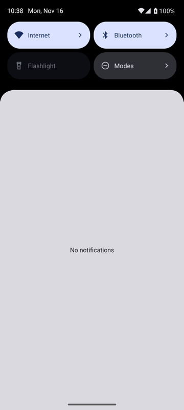

# 検証結果

2026-11-16 (Asia/Tokyo)。参考アプリの移植後、実際のBun中継・stdio MCP・ネイティブアプリを使用して確認しました。テスト用の画面データや架空の成功応答を製品に追加していません。

## 自動試験・ビルド

| 対象 | 実行 | 結果 |
|---|---|---|
| relay | `bun test --cwd relay` | **548 pass / 0 fail** |
| MCP | `bun test --cwd mcp` | **232 pass / 0 fail** |
| iOS Kit | `swift test --package-path ios/OyobidashiKit` | **185 tests / 1 skip / 0 fail** |
| Android core | JDK17で `android/gradlew -p android :core:test` | **183 tests / 1 skip / 0 fail** |
| 実サーバー結合 | JDK17で `bun test --cwd integration` | **18 pass / 0 fail** |
| TypeScript | relay / mcp の `tsc --noEmit` | 成功 |
| iOSアプリ + Notification Service Extension | XcodeBuildMCP、iPhone 17 / iOS 27.0 | ビルド・インストール・起動成功 |
| iOS実機向け署名 | `xcodebuild -destination generic/platform=iOS -allowProvisioningUpdates build` | 本体・通知拡張の開発署名付きビルド成功、署名検証成功 |
| Androidアプリ | `:app:assembleDebug`、API36 Google Play ARM64 | APK生成・インストール・起動成功 |

単体試験のskipは、環境変数で実サーバーを指定して走らせるLiveRelay試験です。両OSとも別途結合試験で実サーバーに接続して実行しています。SwiftのコンパイルにはCallKit/AVAudioSessionの非推奨API警告が残っています (iOS17互換)。

結合試験は実際の中継プロセス・stdio MCP・iOS URLSession・Android OkHttpを使用し、ペアリング、選択/テキスト/音声としての回答、取り消し、同時回答、再起動後の永続化、在席によるチャネル変更、優先度変更、拒否フィードバック、一方向通知取り消しを検証します。`human://status`の読み取り・購読・更新通知・購読解除も実クライアントで確認しました。

## 画面・Pushを含む確認

| 環境 | シナリオ | 結果 |
|---|---|---|
| iOS Simulator | 深いリンクでペアリング → 通常起動 → 未回答一覧 | 成功 |
| iOS Simulator | 選択ボタンから回答 → MCPにchoice_index付きで返却 | 成功 |
| iOS Simulator | 背景の説明 → 返信画面で長い文章を入力 → MCPへ全文返却 | 成功 |
| iOS Simulator | 開いている質問をエージェントが取り消す | 送信UIが閉じ、取り消し状態を表示 |
| iOS Simulator | 通話のアプリ内代替画面 → 拒否 | pending/textへ移行、MCPにdeclined |
| iOS Simulator | 「30分取り込み中」を設定 → urgent/callで質問 | textへ切り替え |
| iOS Simulator / APNs sandbox | 実際のAPNsへ通常通知・VoIP通知を送信 | 両方ともAPNs成功応答。`apsd`で通常/`.voip`トピックの受信、SpringBoardで通常通知と2アクションの登録を確認 |
| Android Emulator | QRと同じペアリングURI → 通常起動から未回答一覧 | 成功 |
| Android Emulator | アプリをバックグラウンドへ → **実際のFCM** → 通知の選択ボタン | MCPに「回答できました」/choice_index=0が返却 |
| Android Emulator | 通知以外から起動 → テキスト画面で返信 | 入力した全文がMCPに返却 |
| Android Emulator | 実FCM着信 → Android Telecom | `self_mng`, `voip=true`, `RINGING`、CallStyleのAnswer/Declineを確認 |
| Android Emulator | 標準着信通知のDecline | 端末ID付きdeclinedをMCPで確認、質問はtextとして継続 |
| Android Emulator | Answer → マイク許可 → foreground service | 通話中画面・TTSエンジン接続を確認 |
| Android Emulator (音声出力なし) | Answer → 通話画面の「切断」 | MCPに端末ID付き`hangup`、質問はpending/textへ移行。実音声の往復は対象外 |
| Android Emulator | バックグラウンドの一方向通知をMCPから取り消し | OSのNotificationRecordが **1件→0件**。アプリの一覧更新だけによる代替ではありません |
| Claude Code | 実際のサブスクリプション認証で質問/人間の回答を構造化判定 | 約3.3秒で `resolved:true` と回答要約、終話のお礼を返却 |

Androidの長文入力はエミュレータ上の高速キーボード注入で文字の取りこぼしがあったため、各入力を確認し、通常の入力速度で全文を確認してから送信しました。製品内のテキスト欄も即時の編集状態を保持します。確認した返信: “Announce today. Start at 10am. Check error rates before continuing.”

通知の画像は検証途中のものです。最終版のactionsモードは選択ボタンのみを表示します。

## iPhone実機の追加確認 (2026-11-16)

iPhone 16 Pro / iOS 26.7.2へ開発署名付きアプリをインストール・起動し、ユーザー操作でペアリング、通知・マイク・音声認識の許可を設定しました。通常APNs / VoIPトークンは実機から別々に登録されました。

| シナリオ | 確認できた結果 |
|---|---|
| CallKit着信・応答 | 実機の標準着信バナーを撮影。端末ログで`voip_received` → `answer_action` → `audio_activated`を確認 |
| 実音声の回答 → Claude → MCP | 「明日の午前10時に始めてください」が認識され、`input_method: voice` / `answered` / `outcome: resolved`として返却 |
| お礼後の自動終話 | `final_reply_finished`の後に`phase=ended`・CallKitの`reason=resolved`を確認。ユーザーもお礼後の自動終話を確認 |
| 応答後の画面 | 表示されない不具合を修正し再インストール。再試験で質問と赤い終了ボタンを表示する画面を撮影し、ユーザーも正常と確認。終話後は一覧へ復帰 |
| アプリを離れて着信 → 途中終了 → 通知 | ユーザーがホーム画面に戻してから着信。応答・読み上げの後に手動終了し、`hangup`と実機の端末ID、`pending` / `delivery_mode: text`をMCPで確認。実機で同じ質問の通知バナーを撮影 |
| 切り替わった通知 → テキスト返信 → MCP | ユーザーが通知から質問を開いて返信。`input_method: text` / `answered`で「明日の10時。午前」がMCPに届き、ユーザーにも入力内容との一致を確認 |

初回にWebSocketとVoIP Pushの同じUUIDの報告が競合し、代替画面が重なる問題を発見しました。CallKitの`callUUIDAlreadyExists`を既存着信の継続として扱うよう修正し、再試験では重複する代替画面が出ないことを確認しました。通話関連の回帰試験は51件成功・失敗0件です。音声権限は着信中の初回ダイアログを避けるため、一覧・設定から事前に許可できるようにしました。

応答後の通話画面には質問、読み上げ・聞き取りの状態、認識中の字幕、終了ボタンを表示します。アプリ内の終了ボタンからもCallKitの終了アクションを通し、同じ途中終了処理を使用します。

最終確認リクエスト: 音声解決 `req_01M7GYKJS18HG2QTWNEQ346P1T`、途中終了後のテキスト回答 `req_01M7GYPJWTK3DCFG9W84RABVXK`。両試験とも本物のstdio MCPと中継を使用しました。音声解決では実機のマイク・音声認識・Claude・読み上げ・CallKitを経由しました。テスト用未回答リクエストは残っていません。

## 複数端末・通知取り消しの追加確認 (2026-11-16)

同じ中継にペアリングした端末へ配信する1対多構成です。最初の応答端末が通話を所有し、他端末の応答・発話は中継が拒否します。

| シナリオ | 実動作で確認した結果・限界 |
|---|---|
| Android Emulatorで応答 → iPhoneの着信停止 | 両端末の着信画面を確認し、Androidの標準Answerボタンを操作。実機ログに同じrequest IDの`reason=answeredElsewhere`が記録され、ロック中のiPhoneからCallKit着信画面が消えた。Android側はその直後に`failed`へ移行したため、音声通話継続の成功としては数えない |
| iPhoneで応答 → Androidの着信停止 | AndroidのAnswer/Decline通知を撮影後、ユーザーがiPhoneで応答。MCPで実機が所有する`active`通話の継続を確認した時点で、Androidの通知は0件となり、Telecomは10:38:00の`RINGING`から10:38:03の`DISCONNECTED`へ移行。その後エージェントが取り消し、iPhoneの標準通話画面にも「終了」を確認 |
| エージェントが未回答の質問を取り消す → iPhone通知削除 | 上記のテキストへのフォールバック通知をMCPで取り消し、iPhoneの通知センターから消えることを画面で確認 |
| 一方向のお知らせを取り消す (初回) | ユーザーが通知の残存を確認。不具合を発見: `kind=notification`を全状態で削除対象から除外していた |
| 修正後、一方向のお知らせを取り消す | 再インストール後、ユーザーがアプリを一度開いてホームへ戻った状態で実APNs配信。ロック画面上の通知を確認してからMCPで取り消し、アプリを開かずに通知が消えたことを前後の実機画面で確認 |

一方向のお知らせは`notified`のときだけ表示を維持し、`cancelled`等なら削除するよう修正しました。WebSocket更新と、未取得の通知をHTTPで取得する経路の両方に回帰試験を追加し、修正前の失敗・修正後の成功を確認しました。また、取り消し等のAPNs更新を受けた時点で通知を削除し、中継への再取得を待たないようにしました。Swift全185件・skip1件・失敗0件、実機向けビルド成功です。

識別子: Androidから応答 `req_01M7GZ7FRCFPN7SNEJ0J288YY1`、iPhoneから応答 `req_01M7H021PQ6XVCQM77G3ND7A7W`、初回不具合 `req_01M7GZCDKHM22F7BN4XNAH3P0N`、修正後通知取消 `req_01M7GZRQG7X5GYXQBYQ1WC9P9E`。端末間の着信停止は両方向で確認しました。Androidは音声出力なしの専用QAエミュレータです。

## 未確認・外部条件

- iOS実機では上記の通話・テキストへの切り替えを確認済みです。実APNsの選択肢ボタンによる回答は実機では未確認です (アプリ内選択回答はiOS Simulator、実Pushの選択回答はAndroid Emulatorで確認済み)。
- **Androidの音声往復・自動終話は未確認。** Androidエミュレータでは通話中にQEMU2 main loop/CPU threadが停止してADBが切断されました。描画方式を変更しても再現しました。アプリの例外を示すAndroidRuntimeログは確認されていません。このため、音声媒体の安定性や遅延は実機で再確認が必要です。応答完了を待って終話する競合、失敗時の下書き、途中終了・拒否・タイムアウト・取り消しはロジック試験で検証済みです。
- **音声はターン単位。** 全二重音声ストリーミング・発話での割り込みは未実装です。Claudeのサブスクリプションを使い、Geminiのキーは不要です。
- **外出先の通信経路は未設定。** HTTPS/WSSプロキシ対応とアクセス制御の試験・Caddy設定例は用意済みですが、公開ホスト名・証明書・実ネットワークの接続確認は残っています。
- iOSの通知削除を含むPush配信はOSのベストエフォートです。今回のバックグラウンド試験では削除を確認しましたが、圏外・強制終了・OS制限中の即時反映は保証しません。復帰時にサーバーと照合します。[Apple公式: background通知の配送は保証されない](https://developer.apple.com/documentation/usernotifications/pushing-background-updates-to-your-app)。

## この作業環境の設定

- Firebase: `oyobidashi-7a842` (Spark)、Android登録ID `io.github.yusukeiwaki.oyobidashi`。
- `android/local.properties` / `android/app/google-services.json` は設定済み・gitignore対象。
- `.oyobidashi/config.json` はFCMをGoogle Cloud CLIの既存ログインで送る設定。新規サービスアカウント秘密鍵は作成していません。
- Apple Developer: Team `6KG5EF3BN2`、本体 `io.github.yusukeiwaki.oyobidashi` (Push Notifications / Time Sensitive Notifications有効)、通知拡張 `io.github.yusukeiwaki.oyobidashi.NotificationService` を登録済み。XcodeGenの署名チームも設定済みです。
- APNs: キー名 `Oyobidashi Push`、Key ID `7GS4U6H2LS`、APNsのみ・Sandbox & Production・Team Scoped。秘密鍵は `.oyobidashi/keys/` に移動し、鍵と設定ファイルは権限0600・gitignore対象です。中継再起動後、APNs / FCMとも有効です。
- `./scripts/dev.sh` / `./scripts/pair.sh` / `./scripts/mcp.sh` が同じローカル状態ディレクトリを使います。
- Android専用検証AVD: `oyobidashi_qa`。既存AVDのデータは消去していません。
