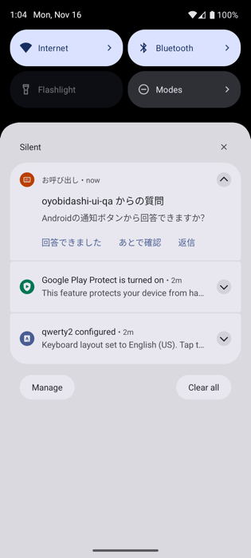
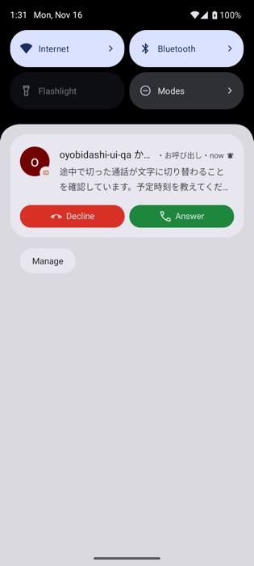
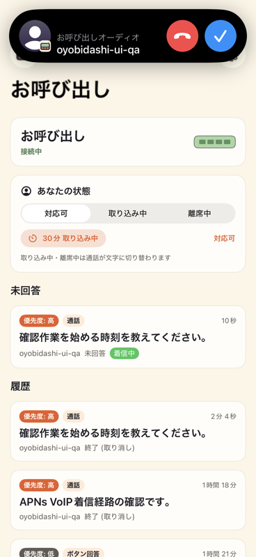
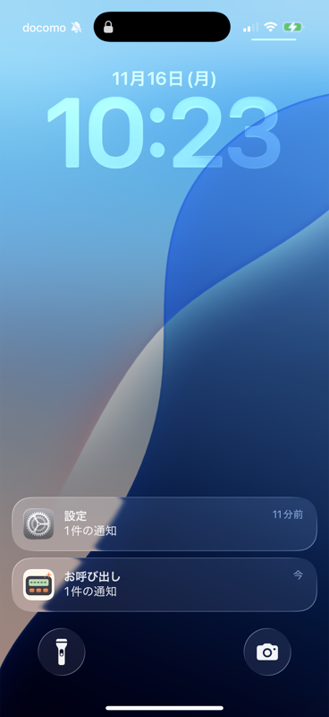
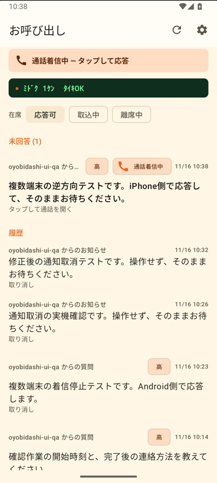
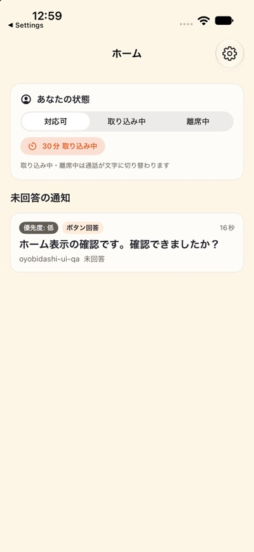
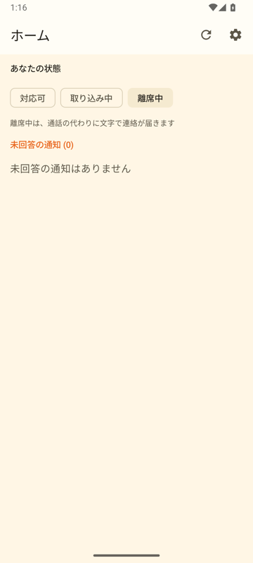
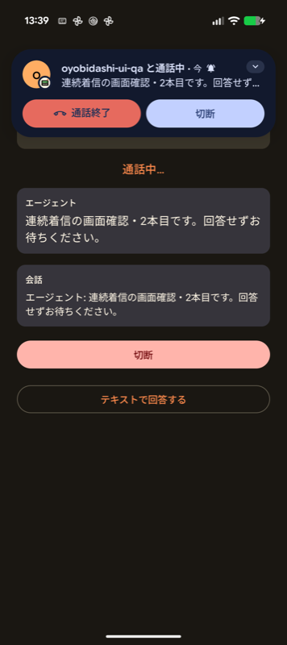
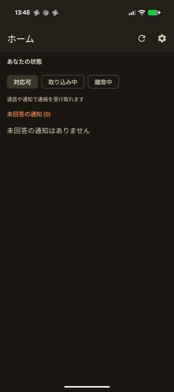
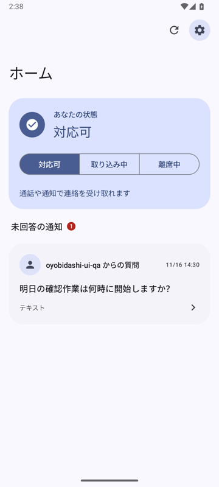

# 検証結果

## 両OSの購読反映と購入アカウントの紐づけ (2026-11-19)

`main` の `9e3f2fd` を基準に、iPhone 16 ProとPixel 10aを、実PostgreSQLを使う隔離APIへペアリングして検証した。iPhoneは開発署名版でApple Sandboxを使用した。PixelはPlayストアから内部テスト版をインストールし、ライセンステスターのテストカードで購入した。Playのテスト購入に権利を付与する条件は隔離APIだけに設けた。

| 実機の確認 | 結果 |
|---|---|
| iPhoneでの購入と復元 | 既存のSandboxテスターでは再認証が成功し、復元できる有効な購読がないと表示された。新規テスターで初回購入すると、サーバーがApp AttestとAppleの取引署名を検証し、購入元アカウントに購読を登録。iPhoneはFREEからPLUSに変わった。後の再購入試験でStoreKitが返した過去の期限切れ取引では、FREEのままだった |
| App StoreからAndroidへの反映 | 同じお呼び出しアカウントのPixelでも、iPhoneのSandbox購入後にPLUSを表示。App Storeで購入した購読をiPhoneの設定で管理する案内を確認した |
| Google PlayからiPhoneへの反映 | Play内部テスト版 `0.2.0`（バージョンコード2）で、実際のPlay Integrity判定、Google Play Developer APIでのテスト購入の照会と承認を経て、PixelがPLUSに変わった。同じお呼び出しアカウントのiPhoneではプラン画面を開き直すとPLUSが表示され、AndroidのGoogle Playで購読を管理する案内を確認した |
| Google Playの購入時アカウントIDと別UIDでの復元 | バージョンコード2での購入では、Googleの購入応答にアカウントIDが含まれなかった。購入時にIDを渡す最新版を `0.2.1-internal`（バージョンコード3）としてPlayの内部テスターに公開し、PixelをPlayストアから更新して再試験した。Googleが返した `obfuscatedExternalAccountId` は購入元UIDに対応するIDと一致し、PLUSになった。同じGoogleアカウントのまま別のお呼び出しUIDで「Google Playの購入を復元」を実行すると、同じ有効な購入を照会できたが、IDは別UIDと一致せず、FREEのままだった。購入元UIDに戻すとPLUSを表示した |
| Apple Sandboxの購入時アカウントIDと別UIDでの復元 | iPhoneでSandbox購入し、署名済み取引の `appAccountToken` が購入元UIDに対応するIDと一致することを確認した。同じSandboxテスターのまま別のお呼び出しUIDへ切り替え、「購入を復元」からAppleに再認証した。サーバーは同じ有効な購読を検証したが、別UIDには権利が付かず、iPhoneはFREEのままだった。購入元UIDに戻すとPLUSを表示した |

バージョンコード3はUSB経由の隔離APIに接続できる内部テスト用ビルド。自動試験は、実PostgreSQL／Redisを使う課金テスト31件と、Androidの単体試験280件がすべて成功した。課金テストでは本番コードがPlayのテスト購入に権利を付与せず、承認もしないことを確認した。

### 本番クラウドへの接続確認

Railway本番に `9e3f2fd` のAPIとworkerをデプロイし、両サービスの正常起動とAPIのヘルスチェックを確認した。iPhoneとPixelでMCPからの呼び出しに選択肢で回答し、PixelではバックグラウンドでOSの通知を確認した。この回の本番音声試験ではiPhoneは不応答となり、Pixelはマイク未許可だったため、実機からの発話と読み上げまでの往復は未確認。両端末を本番クラウドに戻して接続を確認し、隔離APIとDBを撤去した。

当日時点で本番APIの両ストアの商品IDは未設定で、課金は無効。実課金、本番のApp Storeサーバ通知／Google Play RTDNによる権利の更新・失効、配布候補ビルドによる本番音声は公開前の確認項目として残る。

## Appleサーバ通知の実機確認 (2026-11-18)

App Storeの署名付きデータの長さ上限（16,384文字）が通知本体にも適用されており、取引情報と更新情報の両方を含む通知を401で拒否する状態だった。通知本体だけ上限を65,536文字へ広げた（リクエスト本文は64KBで制限済み）。通知内の取引情報・更新情報と、端末から届く取引は16,384文字のまま。

| 確認 | 結果 |
|---|---|
| 自動試験 | 実物相当の長さの返金通知が204で受理され購読が失効すること、端末からの16,384文字超の取引は無視されることを追加。cloud **465 pass / 21 skip / 0 fail**、型検査成功 |
| 実機のSandbox購入 | iPhone 16 Proを隔離した検証用API（実PostgreSQL17／Redis7）へ一時的にペアリングし、利用者がSandboxで購入。実機のApp Attestと購入の署名検証を経て、有効なApple購読1件を登録 |
| 実物のサーバ通知 | 検証用APIを一時的な公開URLで受け、App Store ConnectのSandbox用通知URLに設定。自動更新の通知（`DID_RENEW`、Sandbox）が届き、**全体18,773文字**（取引情報5,350文字、更新情報5,053文字）、応答204。端末を操作せずに、期限切れだった購読が有効へ戻った |

購入直後の通知は届かず、2回目の更新から届いた。原因は確認していない。実際の返金通知（`REFUND`）と本番環境の通知は未確認。通知の中身・アカウント情報・署名データは記録していない。

同じ調査で、音声通話に日次・月次の総量上限がないこと（毎分8ターンを1時間続けても停止されず480回すべてがモデルに届く）、自動停止がUID単位で新しいUIDなら同じ端末で再開できること、1つの購入を2アカウントが交互に復元すれば両方が購読扱いになることを、隔離した試験で確認した。この時点ではいずれも未対応。後続の変更で音声発話はアカウントごとに直近60分で30件までとなり、購読の別UIDでの復元は[翌日の実機検証](#両osの購読反映と購入アカウントの紐づけ-2026-11-19)で権利が付かないことを確認した。

## クラウド音声の端末証明・自動BAN (2026-11-18)

クラウド通話の応答・発話に、端末にひも付く10分間の音声トークンを必須化した。iOSはApp Attest鍵と更新時のアサーション、Androidは登録時および6時間ごとのPlay Integrity判定と、更新時のAndroid Keystore署名を使用する。MCPやHTTPだけで作った偽端末は端末証明なしではモデル用の発話ジョブを登録できない。無料音声の通常の回数上限は設定していない。

端末証明済みの通話でも、異なる発話IDを1分間に30件、受理済み発話を10分間に90件、または2000文字超の発話を5分間に3件送信すると、そのFirebase UIDを期限なしで自動停止する。同じ発話IDの再送は数えない。BAN後のAPI・OAuth・ワーカー経路と、別アカウントへの影響がないことを単体試験と実PostgreSQLで検証した。新しいUIDの作成までは阻止しない。

最終検証: 隔離した実PostgreSQL17／Redis7を使う `./scripts/test-cloud.sh` **482 pass / 0 fail**、cloud型検査成功、iOS Kit **262 tests / 1 skip / 0 fail**、Android core/app単体試験とDebug APKビルド成功、`git diff --check`成功。iPhone 16 Proへ署名付きDebugアプリを上書きインストールし、一時APIへの再ペアリング後、実機の着信応答がクラウドで`active`となったことを確認。隔離DBにはApp Attest鍵と音声トークンが各1件記録され、端末証明のない応答は試験で403を確認した。実機のマイク発話・LLM応答、Android実トークン、10分後の実機更新は今回実施していない。検証用通話を取り消し、iPhoneを元のクラウドへ再ペアリングして直近の端末活動を確認し、一時APIの端末登録0件、UI補助アプリの削除、一時コンテナの削除まで確認した。

## 通話・MCP・課金の悪用対策 (2026-11-18)

追加の攻撃プローブを回帰試験へ取り込み、課金の返金済みJWS再送、古い更新による期限の巻き戻し、共有JWSの複数UIDへの複製、Google Playのリンク済み旧購入トークン、無効な購入同期による試行枠の回避を修正した。Appleの状態更新とGoogleのトークン移行は実PostgreSQLの単一接続プールでも検証した。AppleのFAMILY_SHARED・ASSIGNEDは、署名された`appTransactionId`ごとに席を保持する設計とし、組織割当を維持した。実際のVPP割当・Appleサーバ通知・Play Integrityの本番トークンは今回検証していない。

MCPのOAuthでは自アプリへの戻り先と無操作リダイレクトを拒否し、外部プロバイダーでのログイン後に明示的な許可操作を要求した。接続済みアプリの一覧・取消し、最後の端末解除時の許可失効、refresh token再送時の許可失効を追加した。通話履歴とモデル入力、同時接続、通知作成・保存数、辞退後の再発信を制限した。無料音声の利用回数に日次・月次上限は設けていない。

検証結果: `./scripts/test-cloud.sh` **474 pass / 0 fail**、cloud型検査成功、relay **559 pass**、MCP **401 pass**、結合 **18 pass**、iOS Kit **261件 / 1 skip**、Android core/app単体とDebug APKのビルド成功。物理iPhone 16 Proへ署名付きDebugアプリを上書きインストール・起動し、実機UI試験2件で設定画面の表示と、外部ペアリングリンクに接続先を示す確認ダイアログが出てキャンセルできることを確認した。試験用UIランナーは削除し、元のアプリを起動した。実機で課金・通話・Pushを再実行した結果ではない。

後続の変更で、全クラウド音声通話へのApp Attest／Play Integrity要求と旧クライアントの更新必須化を実装した。使い捨てUIDによるワーカー占有、登録先ホストを変え続けるOAuth登録、ペアリング画面での相手アカウント表示は引き続き未完了。

## サブスクリプション・端末検証 (2026-11-18)

購読の有無で通話のモデルを切り替える仕組みと、購入登録APIの端末検証(App Attest／Play Integrity)を追加しました。[契約](CLOUD_PROTOCOL.md#subscription-attestation-and-the-voice-model)、[設定](../cloud/README.md#サブスクリプション)を参照してください。

| 確認 | 結果 |
|---|---|
| クラウドの単体・結合試験（実PostgreSQL17／Redis7を含む） | **458 pass / 0 fail**。同じ購入を2アカウントが同時に復元する競合を実PostgreSQLで再現し、保有者が1人に収束することを確認 |
| 既存relay／MCP／実relay結合 | **559 / 401 / 18 pass、0 fail**。strict型検査成功。結合はJDK17を明示 |
| iOS Kit／iOSビルド | **261 tests / 1 skip / 0 fail**。本体・通知拡張の実機向け署名ビルド成功 |
| Android | core **270 tests / 1 skip / 0 fail**、app **12 tests / 0 fail**、Debug APKビルド成功 |
| 製品サイト | ビルド成功。PC・タブレット・スマホ幅で料金表の表示を確認 |

App Attestの検証とApp Storeの署名検証は、試験用の証明書による自動試験に加え、下記の実機とSandbox購入でも確認しました。**Play Integrityの実トークンとストアのサーバ通知は未確認です。** Google Playは今回の対象外です。

### iPhoneでの継続確認 (2026-11-18)

利用者の指定により、商品IDは`me.oyobidashi.ai.monthly`、月額150円に確定。ローカルStoreKit設定の商品IDも合わせました。検証先はMac上の隔離したPostgreSQL17／Redis7とクラウドAPIで、既存のFirebase認証を使用しました。本番へのコミット・push・デプロイは行っていません。

| 確認 | 結果 |
|---|---|
| iPhone 16 Pro / iOS 26.7.2への更新 | 既存の署名設定でビルド・上書きインストール成功。署名済みアプリとプロビジョニングの両方でApp Attestのdevelopment権限を確認 |
| ローカルAPIへのペアリングと無料プラン表示 | 実機の設定に「通話の内容がモデルの学習に使われます。」が表示されることを確認 |
| 無料状態でのMCP | 実際のローカルHTTP APIに接続したMCPの`get_human_status`と`ask_human`の両方に`privacy_notice`が付くことを確認。確認用の質問は取り消し |
| 無料状態での実ワーカー | 実際のローカルAPIへHTTPクライアントからサンプル発話を送り、ワーカーによる無料用モデルの呼び出し、`effort=medium`、HTTP200、回答完了を確認。今回1回の待ち時間はAPI受付から完了まで **8.4秒**（モデル呼び出しは約8.3秒）。マイク入力・読み上げを含む測定ではない |
| 商品情報がないときの購入操作 | 購入ボタンが有効なのに押しても反応しない状態を実機で再現。取得中の表示、取得できない場合の説明と再読み込み、取得前の購入ボタン無効化を追加し、更新した実機で再確認 |
| ストア登録後の商品情報取得 | 実機を一時的にローカルAPIへ接続し直して確認したが、商品情報と料金は取得できず、購入ボタンは無効のまま。Appleのサインインを伴わない取得だけを1回確認し、購入・復元や追加のサインイン試行は行っていない。商品取得失敗の原因は未特定 |
| Appleの公開サンプル | [公式ガイド](https://developer.apple.com/documentation/devicecheck/attestation-object-validation-guide)の公開データで証明書チェーン、nonce拡張、AAGUIDの読取を確認。今回のiPhoneから取得したアテステーションではない |
| 検証後の復帰 | iPhoneを元のクラウドへ再ペアリングし、設定の接続先とローカルのプラン欄が消えることを確認してホームへ復帰。実機操作用の補助アプリを削除し、隔離API・DB／Redisを終了 |

修正後の検証はcloud **458 pass**（隔離した実PostgreSQL／Redis）、relay **559 pass**、MCP **401 pass**、integration **18 pass**、iOS Kit **244件／1 skip**、Android core **270件／1 skip**・app **12件**。すべて失敗0。クラウドの型検査、実機向け署名付きiOSビルド、Android Debug APKビルドも成功しました。

同日の継続作業で、利用者が指定したストア名「Oyobidashi - AIがあなたをお呼び出し」でアプリを登録し、商品`me.oyobidashi.ai.monthly`を作成しました。期間は1か月、日本の価格は150円、日本語の表示名・説明を保存しました。配信地域は検証用に日本を設定しています。ストアの審査・公開は行っていません。Apple側のビジネス情報は入力・提出し、その後、有料アプリ契約の「有効」を確認しました。管理画面で読み込みエラーと再サインインへの遷移が繰り返されたため、Sandboxアカウントとグループの表示設定の確認は続行待ちです。

02:20 JST時点で、[公開の利用者報告](https://www.reddit.com/r/appledevelopers/comments/1xypbat/is_the_app_store_connect_down_at_the_moment/)にも同じサインインループ・本人確認エラーが複数あり、個別アカウントのロックとは断定していません。02:33に[障害の報道](https://9to5mac.com/2026/11/17/icloud-app-store-and-other-apple-services-hit-by-ongoing-outage/)があり、02:36の確認では[Appleの公式稼働状況](https://developer.apple.com/system-status/)もApp Store Connectの障害を掲載（発生01:50 JST、継続中）しました。利用者の指示で追加のサインイン試行を止め、公開情報で復旧の確認を続けました。

その後、SNSに複数の復旧報告が出たため、認証情報を入力せず既存セッションで管理画面を1回表示確認しました。アプリ一覧とビジネス画面は表示され、有料アプリ契約の「有効」を確認できましたが、アプリ詳細へ進むと再びサインイン画面へ戻りました。この時点では公式にもApp Store Connectの障害2件が残っており、購読設定と実機購入の検証は再開していません。

利用者が再度アクセスできた後、既存の購読グループ（1商品）とSandbox管理画面の表示を確認しました。Sandboxテスターは利用者の操作で1件登録され、グループの日本語表示名「通話プラン」も保存しました。商品ID、期間1か月、商品の「提出準備中」を再確認しています。Macの検証API・ワーカーを再起動し、無料状態の実MCPで両ツールの`privacy_notice`を再確認しました。端末未登録でも返る結果なので、これを端末との接続成功とは扱っていません。

その後、端末のローカルAPIへのペアリングを確認しました。Sandboxサインイン前の実機価格は **$0.99／月** でしたが、日本のSandboxテスターでサインインすると **¥150／月** に切り替わりました。Appleの購入確認でも月額150円、テスト用で請求なしの表示を確認しました。アプリはStoreKitの`displayPrice`を表示し、Storefrontの更新時に商品を再取得しており、通貨を上書きしていません。

### iOSのプラン選択UI (2026-11-18)

設定には「現在のプラン」、プラン名、学習利用の説明、右側の「変更」を表示します。「変更」から開くモーダルに無料・有料の選択肢、アップグレード／App Storeの購読管理、下部のテキストリンク「購入を復元」を配置しました。解約はAppleの管理画面で行い、サーバーで利用権がある間は有料プランを維持します。検証済みの更新情報が自動更新オフで、その終了日時がサーバーの有効期限と一致する場合のみ、終了日時からFREEになる案内を表示します。更新状態が不明な場合は有効期限のみを表示します。

| 確認 | 結果 |
|---|---|
| プラン表示の単体試験 | **17件／0 fail**。無料、購読継続、解約予約、期限切れ、更新情報不明、別の継続中の購読、組織割当、課金無効、商品取得中・失敗、二重操作防止、通貨保持について、表示文言と選べる操作を確認 |
| iOS Kit全体 | **261件／1 skip／0 fail** |
| 実機向けビルド | 既存署名によるビルド・上書きインストール・起動成功 |
| 実機の無料プランUI | 接続中のiPhoneをXCTestで操作し、「現在のプラン」「無料プラン」、学習利用の説明、右側の「変更」を確認。モーダルの選択肢、購入の復元リンク、有料を選択した後のアップグレードボタンを確認 |
| Sandbox購入・実App Attest・署名検証 | 利用者が端末で認証して購入。Appleの完了画面に`Environment: Sandbox`を確認。実機のアテステーション、アサーション、購入の署名検証を経て、隔離DBにApp Attest鍵1件・有効なApple購読1件が登録され、設定が有料プランへ切り替わった |
| 購読後のMCP | 実HTTP APIに接続した`get_human_status`と`ask_human`の両方で、`privacy_notice`が付かないことを確認。確認用の質問は取り消し |
| 購読後の実ワーカー | 同じ利用者のサンプル発話が標準側を呼び出し、`effort=medium`、HTTP200、回答完了を確認。1回の待ち時間は受付から完了まで **8.5秒**（モデル呼び出し約8.3秒）。マイク入力・読み上げを含まない |
| 実機での購入の復元 | モーダル下部の「購入を復元」からAppleの認証を経て、「購入情報を確認しました。」を表示。有料プランを保持し、サーバーで新しいアサーションを確認。再インストールや別端末への復元は未実施 |
| 解約予約・終了日時 | 「無料プランに戻す」からAppleの`[Sandbox]`購読管理を開き、解約を確認。アプリに戻って、UIツリーで終了日時から無料になる案内と「無料プランへの変更を予約済み」を確認。終了直前も有料プランを維持し、MCPに学習利用の注意は付かなかった |
| 期限後の切り替え | Sandboxの実際の期限到達後、アプリのモーダルと設定が無料プランへ自動更新。有効なApple購読は0件となり、MCPの両ツールに`privacy_notice`が戻った。実ワーカーも無料側で回答完了（今回1回は約7.9秒）。時刻や購読状態をDBで改変していない |
| 検証後の復帰・後片付け | iPhoneを元のクラウドへ再ペアリング。設定の「Oyobidashiクラウド」「接続中」、課金未設定の接続先でプラン欄が表示されないこと、クラウド側で直近の端末通信を確認。ホームへ戻し、今回の補助アプリ2個・隔離API／ワーカー・PostgreSQL／Redisを終了・削除。元からオンだったUIオートメーション設定は変更していない |

実機操作の補助アプリは、当初、UIオートメーションモードの有効化待ちでタイムアウトしていました。その後の起動ではテストが開始され、上記の実機UIを操作・撮影できました。生の端末ログ・アカウント情報・署名データは記録に含めていません。

実機検証後、利用者の指定でiOSの表示名を「FREE」「PLUS」へ変更しました。FREEには料金行を表示せず、PLUSはStoreKitの料金に`/月`を付けます。説明は「通話の内容がAIモデルの学習に使われます。」「通話の内容がAIモデルの学習に使われません。」です。設定・解約案内も同じプラン名へ統一し、表示テスト17件が再び成功、generic iOS向けの署名ビルドも成功しました。その後、再接続したiPhone 16 Pro／iOS 26.7.2へ上書きインストールし、現在のプランとFREE／PLUSのモーダルを実際に撮影・目視確認しました。PLUSの価格は`¥150/月`でした。

個人の撮影スキルと資料生成スクリプトにも、必須の「12-current-plan」「13-plan-change」と、追加のPLUS・解約予約中・期限後の場面を追加しました。課金状態・ストア環境をmanifest、ギャラリー、READMEへ記録し、既定セットの完了判定も課金画面を含めます。実機ドライバーの`--identifier`による「変更」とPLUSカードの操作、および原寸PNGの取得を実機で確認しました。今回の画像2枚（1206×2622）、比較ギャラリー、一覧画像、ZIPはgit管理外の`docs/product-reference/2026-11-18-billing-free-plus/`と同名のZIPへ保存し、画像・表示・リンク・梱包内容を確認しています。今回はiPhoneの課金2場面だけが対象で、両OSの既定セット全体の撮り直しではありません。購入・復元・解約操作を追加では行わず、撮影後は元のクラウド接続と端末台数へ復帰し、一時API・DB・実機操作用補助アプリを片付けました。

検証用ワーカーのモデル設定は利用者が私有の環境ファイルに用意したものを使用し、値は記録していません。**Mac上の検証APIに公開URLを設けていないため、更新・解約・返金のAppleサーバ通知は未確認です。** 自動更新が実際に発生する場面、実際の返金、別端末・再インストール後の復元も未実施です。Google Playは今回の対象外です。コミット・push・デプロイ・ストア審査への提出は行っていません。

### 実際に支払わずに試す方法

| 方法 | 試せること | 制約 |
|---|---|---|
| Xcodeの StoreKit Testing (`ios/App/Oyobidashi.storekit`) | 購入画面、復元、更新・解約・返金の操作と表示 | 署名がXcodeのローカル証明書なので、サーバーは受け付けない。Simulatorは App Attest 非対応 |
| App Store の Sandbox（実機＋Sandboxテスター） | 実物の署名での購入からサーバー反映、サーバ通知まで。月額は数分で更新 | App Store Connectに商品が必要。サーバーは`APPLE_IAP_ENVIRONMENTS`に`Sandbox`、Xcodeから入れたビルドは`APPLE_APP_ATTEST_ENVIRONMENTS`に`development`が必要 |
| TestFlight | 配布版と同じ App Attest (production) での一連の流れ。課金は発生しない | 購入はSandbox扱い |
| Google Play のライセンステスター（内部テスト版） | テスト用の支払い方法での購入、数分ごとの更新、Play Integrity、通知 | Playから入れたビルドが必要。手元でビルドしたAPKは検証に通らない |

### Google Play の初回内部テスト (2026-11-18)

`me.oyobidashi.android` を Play Console に登録し、Google 管理のアプリ署名鍵と別のアップロード鍵を確認しました。内部テストに `0.2.0`（バージョンコード `2`、対象 API 36）を公開しました。`me.oyobidashi.ai.monthly` の基本プラン `monthly` は日本で月額150円・自動更新です。既存の Google Cloud プロジェクトを Play Integrity にリンクし、Play Console から送ったテスト通知が専用 Pub/Sub トピックに到達することを確認しました。

Android の単体試験と Debug APK・署名付き AAB、iOS Kit の単体試験と iOS Simulator 向けビルド、実 PostgreSQL／Redis を使うクラウド試験を確認しました。自動試験では、同じ利用者の iOS 購入が Android に反映され、別の利用者には反映されないことも確認しました。この時点では、実機のテスト購入、Play Integrity の実トークン、購読の更新・解約通知のクラウドへの反映は未確認です。

続いて、同じ Google アカウントを内部テスター・ライセンステスターに登録し、招待の受諾と Pixel 10a の Play ストアでのアカウント一致を確認しました。購入検証サービスアカウントには対象アプリの権限を付与し、Google Play Developer API が検証用の無効な購入トークンを `400` で拒否するところまで確認しました。Play Console のトラックには「内部テスターに公開」と出ていますが、参加後のダウンロード先は Chrome で `Not Found`、Pixel で「アイテムは見つかりませんでした。」と表示され、実機のインストール・購入には進めませんでした。Play 版が入手できるまで Pixel の開発版は保持しました。

22時台の再確認で配布ページが開くようになりました。Pixel 10a（Android 17）から開発版を削除し、Play ストアから `0.2.0` を入れ直しました。インストール元は `com.android.vending` でした。隔離した検証用 API にペアリングし、設定の FREE、本番向け表示の月額150円、購入画面の「テストカード、常に承認」と「請求が行われることはありません」を確認しました。テスト購入後、実際の Play Integrity および購入照会を経て検証用 DB に有効な Play 購読が1件登録され、設定が PLUS に切り替わりました。認証済みの `/v1/presence` に `voice_training` が付かなくなることも確認しました。Pixel は Play 版のまま Oyobidashi クラウドへ再ペアリングし、接続表示を確認しました。

別の隔離DBで前回の Play テスト購入を再同期し、Pixel の「Google Playの購入を復元」で「Google Playの購入情報を確認しました。」を確認しました。Google Play Developer API でもテスト購入かつ承認済みでした。「Google Playで購読を管理」から解約すると Google の状態が `CANCELED` になり、22:33:17 JST の期限までは PLUS を保ちました。期限後に Google の API で `EXPIRED`、Pixel の設定で FREE、検証用 DB に有効な Play 購読がないことと `/v1/presence` の `voice_training` が戻ることを確認しました。アプリまたはサーバーの時計・購読データは書き換えていません。

同じ隔離環境と利用者に iPhone 16 Pro と Pixel 10a をペアリングし、両方が FREE であることを確認しました。iPhone でアップグレードを押すと、StoreKit は当日16:46:38 JST に期限切れになった Sandbox 取引を返しました。購入結果と StoreKit の更新で届いた取引もサーバーへ同期する修正を入れ、サーバーの取引署名検証と、期限切れにより PLUS が有効にならないことを確認しました。その後、iPhone の Sandbox 設定にある「トランザクションを開始」で新規購入し、サーバーが同じ利用者に有効な Apple 購読を1件登録し、`/v1/presence` から `voice_training` が消えることを確認しました。iPhone と Play 内部テスト版の Pixel の両方で PLUS が表示され、Pixel には「App Storeで購入した購読は、iPhoneの設定から管理できます。」と案内されました。

組織による一括購入(Apple Business／Apple School Manager)の席は、`ownershipType`が`assigned`のトランザクションとして届き、取り消しは`revocationType`が`ASSIGNMENT_REVOKE`になります(Xcode 27のStoreKit定義で確認)。席ごとに`originalTransactionId`が分かれるかどうかはAppleの文書を取得できず未確認のため、複数のアカウントが同じIDを保有できる扱いにしています。

## Push送信先の再インストール・有効期限 (2026-11-17)

LAN relayとクラウドの両方に、端末を識別する`push_client_id`による旧ペアリングの失効と、通常Push／VoIPそれぞれの登録から30日での送信停止を追加しました。送信成功や他のAPIへのアクセスでは登録期限を更新しません。既存DBは過去の最終接続時刻 (なければ作成時刻) を引き継ぎ、再起動で期限を延長しません。クラウドの32台上限でも同じ端末の置き換えは可能で、別端末の追加は拒否します。

USB接続のPixel 10aとiPhone 16 Proに更新版をインストールし、既存のAPNs／FCM設定を使う隔離したLAN relayで確認しました。既存のクラウドDBには期限変更などの試験操作をしていません。

| 実機の確認 | 結果 |
|---|---|
| Androidのアンインストール → 再インストール → 再ペアリング | 未ペアリング画面に戻る。FCMトークンが変わっても端末識別子が一致し、旧端末行が削除され、新しい登録だけが残る |
| Androidの新登録への通常Push | 実FCMが受け付け、OSのNotificationRecordにアプリの通知があることを確認 |
| iOSのアンインストール → 再インストール | Keychainから同じペアリング・端末識別子を復元。変更された通常APNsトークンで上書き。VoIPトークンは同じ値で、再登録時刻が更新されることを確認 |
| iOSの再ペアリング | 同じ端末識別子で旧端末行を削除。通常Push・VoIPとも新しい端末行に登録 |
| iOSの新登録への通常Push | WebSocket配信0件の状態で実APNsへの送信が成功。バナー表示は今回未確認 |
| 両端末の登録期限を過去にした試験 | 検証用DBで期限を過去にすると`push_attempted: 0`。Androidはフォアグラウンド復帰、iOSはプロセスを再起動して、同じペアリングのまま再登録されることを確認 |
| 検証後の復帰 | 両端末を元のクラウドへ戻し、認証付きAPIのHTTP200と端末2台を確認。隔離relayの端末登録は0件 |

最終の自動検証はrelay **559 pass**、MCP **393 pass**、隔離した実PostgreSQL／Redisを使うcloud **434 pass**、実通信のintegration **18 pass**。iOS Kit **237件／1 skip**、Android core **262件／1 skip**・app **7件**。すべて失敗0。サーバーの型検査、署名付きiOS本体・通知拡張ビルド、Android Debug APKビルドも成功しています。

回帰試験には、別トークンでの再ペアリング、別アカウントへの移動、旧アカウントからの送信待ち・将来の通知、旧登録の遅延更新、トークン取得前の再ペアリング、期限直前に積まれたジョブ、通常PushとVoIPの独立した期限、既存SQLite／PostgreSQLの繰り返し移行、iOSの24時間ごとの同一トークン再登録を含みます。実機の期限試験は検証用DBで時刻を変更したもので、30日間の経過を実測したものではありません。秘密値・ペアリングURL・端末ログはこの記録に含めていません。

本番クラウドのAPI／workerへの今回の変更のデプロイは未実施です。端末の更新と隔離relayでの実機検証まで完了しています。

2026-11-16 (Asia/Tokyo)。参考アプリの移植後、実際のBun中継・stdio MCP・ネイティブアプリを使用して確認しました。テスト用の画面データや架空の成功応答を製品に追加していません。

## Android Material 3の再整理と最終検証 (2026-11-17)

[Android UIの方針](../android/UI_DESIGN.md)に沿って、設定の一律の右向き矢印・行の装飾・グループのカードを外し、標準のListItemで項目名と状態を表示しました。未回答カードは質問と操作名を中心に構成し、対応状態は標準の選択チェックを持つSegmentedButtonへ揃えました。回答の見出し・送信の説明、通常の設定／通話トップバー、会話の重複表示の抑制も反映しています。

Pixel 10a / Android 17へ更新版をインストールし、ライト／ダーク、文字サイズ100%／150%、権限項目から端末設定を開いて戻る操作、接続変更画面からの復帰、回答入力・送信成功・一覧復帰、バックグラウンド着信・応答・終了を確認しました。文字を大きくしたときは状態選択が縦のラジオボタンへ切り替わります。既存のペアリングを保持し、確認後は対応可・文字サイズ100%・ダークモードへ戻しています。

最終のコードに対する検証:

- relay **552 pass**、MCP **390 pass**、セットアップ補助 **14 pass**、実通信の結合 **18 pass**（JDK17）。すべて失敗0。
- クラウドは隔離した実PostgreSQL17／Redis7で **396 pass / 0 fail**。プロセス停止・接続強制断を含む復旧試験を実施。
- iOS Kit **236件 / 1 skip / 0 fail**、署名付きiOS本体・通知拡張ビルド成功。
- Android core **261件 / 1 skip / 0 fail**、app **12件 / 0 fail**。JDK17でDebug APKビルド成功。
- relay・MCP・cloudの型検査、Compose設定の検査、クラウドのDockerイメージビルドが成功。
- コミット対象のファイル一式を隔離コピーし、gitleaksで秘密情報の検出0件。ローカル資格情報・端末ログは対象外。

## 呼び出しの用件 (2026-11-17)

任意の `subject` (40文字以内) をMCP・LAN relay・クラウド・各ネイティブアプリに追加。iPhoneはCallKitの発信者名に添え、Androidは着信画面の質問本文の上に表示する。用件なしの既存リクエストとSQLiteの追加マイグレーション、空白の正規化、文字数・型検証、VoIP Pushから即時に作る発信者名を検証した。クラウドではVoIP Pushに用件だけを追加し、質問・文脈・会話を含めず、通常・取り消しPushにも用件を載せないことを確認した。

- `bun test --cwd relay`: **552 pass / 0 fail**。
- `bun test --cwd mcp`: **390 pass / 0 fail**。
- `bun test --cwd cloud`: **386 pass / 10 skip / 0 fail**。今回、実PostgreSQL・Redisの強制断試験は未実施。
- `swift test --package-path ios/OyobidashiKit`: **236件、1 skip / 0 fail**。
- JDK17でAndroidのcore・app単体テストと `:app:assembleDebug` が成功。
- `bun test --cwd integration`: **18 pass / 0 fail**。実relayからiOS/Android通信クライアントへの一覧・WebSocket・回答後の用件保持、および実stdio MCPからrelayへの用件伝達を確認。
- relay・MCP・cloudの型検査、署名なしiOS Simulator向けアプリビルドが成功。

今回の変更で実機へのPush配信・CallKit着信画面の見え方・音声は未検証。

## クラウド構成・非同期音声 (2026-11-16)

共有API／WebSocket、Firebase IDトークンを使うstdio MCP、PostgreSQLの永続ジョブ、Redisの更新通知、発話単位の共有ワーカーを追加しました。[構成・起動方法](../cloud/README.md)、[障害復旧の契約](CLOUD_PROTOCOL.md)を参照してください。

| 確認 | 結果 |
|---|---|
| クラウドの単体・結合試験（実PostgreSQL17／Redis7を含む） | **394 pass / 0 fail**。隔離した一時DB／Redisを使用。サーバー・ブラウザ双方のstrict型検査成功 |
| 既存relay | **548 pass / 0 fail**、strict型検査成功 |
| MCP | **389 pass / 0 fail**、strict型検査成功。複数プロセスの同時更新・更新前後のアカウント変更・ブラウザからの安全な認証引き渡しも検証 |
| 実relay・stdio MCP・iOS URLSession・Android OkHttp結合 | **18 pass / 0 fail**。JDK17を明示 |
| iOS Kit | **233 tests / 1 skip / 0 fail**。既存の実relay依存試験だけskip |
| Android | core **260 tests / 1 skip / 0 fail**、app **5 tests / 0 fail**、Debug APKビルド成功 |
| セットアップ補助 | **14 pass / 0 fail** |
| iOSビルド | Simulator、物理iPhone向けの本体・通知拡張とも成功。既存署名設定を使用 |
| iPhoneへのインストール・起動・選択返信 | データを保持して更新成功。ロック解除後に起動成功。既存LAN経路で新しい質問の表示・選択返信をユーザーが確認し、サーバーへの`choice`回答保存と実stdio MCPの`wait_for_answer`による同じ回答の取得まで確認 |
| Docker | Linux版Bun1.4.4の実イメージで初期269件成功。認証ページ追加後のイメージもビルド成功。実RailwayでAPI／workerの起動・DB readiness 200・未認証API 401を確認 |
| 配置設定 | RailwayのAPI／workerとも実デプロイとhealth成功。現行Infrastructure as Codeのplan差分なし、Compose・CI YAML・シェル構文・差分の空白検査成功 |
| 秘密情報検査 | git管理対象・追加予定のソースを隔離コピーしてgitleaksで検査し、検出なし。ローカル状態・資格情報はコピー対象外 |

再現した障害は、実ワーカープロセスのSIGKILL、PostgreSQL接続の強制終了、古いワーカーの遅延完了、Redis購読TCPの強制切断、実WebSocket切断・再接続、iOS/AndroidのHTTP本文途中切断、応答だけの喪失、401・429・5xx、プロバイダーの壊れた出力・無応答、停止とジョブ取得の競合、遅いソケット、アカウント切り替えと遅いHTTP応答の競合です。

加えて、履歴が200件を超えた再接続、初回Push待ち中の優先度変更、旧アカウントのPush宛先再登録、未回答一覧からの欠落、最終読み上げの早期終了を試験で保護しています。無言の1000通話は会話ジョブ・モデル呼び出し・占有ワーカー0、変更のない1000接続は500人ずつの変更番号照会だけ、変更時のDBスナップショット取得は最大4並列であることを構造として検証しました。これは本番環境のCPU別収容数の実測ではありません。

以下のLAN確認に続いて、実Firebaseログイン・トークン更新、Railway上の稼働、クラウド経由の実iPhoneへの背景Push・返信・音声通話を確認しました（下表）。集中モード中はバナーが表示されず、通知センターから開いて返信できました。集中モードを一時的にオフにした後は、通知表示・通知からの返信・通話の着信と会話・お礼の読み上げ・自動終話をユーザーが確認しました。実stdio MCPでも選択回答と音声の解決済み回答を受信しました。秘密値・ペアリングURL・端末ログはこの記録に載せていません。

### Railway・Firebaseへの配置 (2026-11-16)

| 確認 | 結果 |
|---|---|
| Railway | 利用者のPersonal workspaceにAPI・worker・PostgreSQL18・Redis8.2を配置。APIは `https://oyobidashi.up.railway.app` で公開、DB/Redisの公開TCP proxyは0件。API・DB/RedisはSingapore、workerは米国西部。アプリは1レプリカずつでhealth成功 |
| 認証 | 既存Firebaseプロジェクトを再利用。匿名とGoogleを有効化し、Googleの連携・独立再ログインの成功を確認してからEmail/Passwordを無効化。匿名での実サインアップ・同じ資格情報の再利用・強制更新・クラウド認証成功。既存のペアリング所有UIDへGoogleをリンクした後、保存済み資格情報を使わない独立したGoogleログインでも同じUID・既存端末1台を取得。無効化後の強制更新、実stdio MCPのget_human_status成功。未認証・不正トークンは401 |
| 配置設定 | 新規サービスで旧railway.tomlが無視されることを実環境で確認し、Infrastructure as Codeへ移行。CLI5.74.0のplanはNo changes。変数はunmanagedで手動設定の秘密値を保持 |
| APIプロバイダー | Meta Model APIのMuse Spark対応を追加。Anthropic/Meta双方の切断・キャンセル・429/5xx・401/403・不正出力・途中応答を含む99件成功。設定名は`MODEL_API_KEY`。Singaporeの当該workerは404 `model_not_found`、同一キーのMacは成功。workerを米国西部へ移した後、製品の会話providerで通常版`muse-spark-1.2`が約4.5秒で`resolved:true`・テスト発話の要約・お礼を返却。続いて実iPhoneの音声往復も成功 |
| Firebase更新の回帰試験 | 実応答のproject_idが数値のプロジェクト番号であるため、設定したプロジェクトIDとの文字列比較を修正。IDトークンのaudで照合し、別プロジェクト・別UID・更新中のログイン切替を拒否 |
| CPU・メモリの初期値 | 端末0台・待機時のRailway計測でAPI約0.0011vCPU/41MB、worker約0.0016vCPU/14MB。多人数や音声処理中の収容数の実測ではない |
| iPhoneクラウド接続 | 新ホスト名へ実機で再ペアリング。通常Push・VoIPトークン登録、質問表示・選択返信を確認。アプリアイコンの画面に戻してからの背景APNsも1回目で配信完了し、ユーザーが通知から開いて返信。実stdio MCPで同じ選択結果を受信 |
| iPhoneクラウド通話 | 集中モードをオフにして着信・応答・マイク・音声認識・Metaによる確認質問・再回答・お礼の読み上げ・自動終話が成功。実stdio MCPで`answered`、`input_method:voice`、`outcome:resolved`、確認用の名前の要約を受信。検証後のlive call・ready/leased jobは0件 |
| 実Railwayの無言・再デプロイ | 別の匿名テスト利用者で通話を開始。無言61秒で発話ジョブ0、worker再デプロイ後もactive・無言142秒で発話ジョブ0。発話の受付はHTTP202・約152ms。同じIDの再送も202・同じturn ID。完了結果は`answered/voice`、ユーザー発話の記録は1件のみ |

実Railwayの自動疎通試験では、結果の取得中に一度503を観測しました。発話は失われず、別の取得操作で保存済みの完了結果を回収しました。端末の503・通信断からの再取得は単体・結合試験で検証済みですが、この自動疎通ドライバーによる手動の再取得を端末の自動復旧の実測とは扱いません。多人数の同時音声負荷や、本番環境のCPU別収容数は未実測です。

ブラウザ認証は、別UIDへの誤ったリンク・別ブラウザ利用者の認証状態・二重操作・ポップアップのキャンセル・プロバイダーとの通信失敗を48件の試験で検証しています。MCPの実ループバックHTTP試験ではOrigin／Host／state／プロジェクト／UID／プロバイダーの不一致、同時コールバック、応答しない検証処理の中断、タイムアウト、復旧前の資格情報バックアップを検証しました。匿名認証の検証用アカウントは端末0台・未連携を確認して削除し、実利用者のUIDとペアリングを保持しています。

iPhoneの再ペアリング後に同じVoIPトークンの登録が省略される不具合も実機確認中に修正しました。ペアリング成功時に登録済みのVoIP状態をクリアし、通常Push・VoIP双方がクラウド端末レコードに登録されることを確認しました。失敗したペアリングで旧登録を保持することと、一時的な登録失敗後に再試行できることを回帰試験で保護しています。

設定画面は、iOS・Androidとも接続先URLの右側に「変更」を配置しました。新しい接続の確立までは現在のペアリングを保持します。両OSのビルドが成功し、iPhoneへデータを保持して更新済みです。ユーザーも実機でURL右側の「変更」を確認しました。

指定された`muse exec --model wonder-1.0-contributor --effort max`は、モデル不存在／アクセス不可で3件とも開始できませんでした。独立した端末・MCP作業は代替の並列エージェントで実施し、認可・共有DB・ジョブの排他制御と復旧処理は主担当が実装しました。

### Apple・GitHub認証の追加 (2026-11-16)

Firebaseの標準方式でGoogle・Apple・GitHubと匿名を有効にし、Email/Passwordは無効を維持しています。認証属性のメールアドレスはFirebase標準の管理に任せ、アプリのPostgreSQLではUIDで認可します。メール属性・プロフィール・メール照合用ハッシュをアプリDBへコピーしません。

| 確認 | 結果 |
|---|---|
| GitHub設定 | 利用者のGitHubアカウントにお呼び出し用OAuth Appを作成。正確なFirebaseコールバックURLを登録し、Client ID・Client SecretをFirebaseへ設定。追加のリポジトリ権限は要求していない |
| GitHub連携・復旧 | 実ブラウザで既存のGoogle連携済みUIDへGitHubを追加。UIDとペアリング1台を保持。続いて保存済み資格情報を使わない独立したGitHubログインでも同じUID・端末1台・クラウドHTTP200を確認 |
| Apple設定 | 利用者の既存Apple Developerチームで本体App IDのSign in with Appleを有効化。Web用Services ID、認証ドメイン・FirebaseコールバックURL、専用のSign in with Apple鍵を設定。FirebaseのAppleプロバイダー有効を確認 |
| Apple連携・復旧 | 本人によるApple Account認証を経て、既存のGoogle・GitHub連携済みUIDへAppleを追加。UID・ペアリング1台を保持。続いて保存済み資格情報を使わない独立したAppleログインでも同じUID・端末1台・クラウドHTTP200を確認 |
| 秘密情報 | GitHub Client SecretとApple秘密鍵はFirebaseへ保存。Apple鍵は権限600のgit管理外ファイルへ保護し、今回のDownloadsの元ファイルは移動済み。既存APNs鍵は変更していない。OAuth秘密情報をRailwayやブラウザbundleへ追加していない |
| Railway | APIを再デプロイ。公開設定が`google,apple,github`、`canLinkExisting:true`、HTTP200であることを確認 |
| 属性の非コピー | 有効なJWTにemail・name・pictureと各プロバイダーのidentitiesが含まれても、認可処理がUIDだけを返す回帰試験を強化。MCPの認証検査がemail・displayName・photoUrl・provider email等を返さない既存試験も確認。対象165件成功、両strict型検査と差分の空白検査成功 |

## 独自ドメインの併用 (2026-11-17)

メインURLを`https://api.oyobidashi.me`へ変更し、既存の`https://oyobidashi.up.railway.app`も同じAPIサービスの8787番ポートへ直接接続する構成を維持しました。

| 確認 | 結果 |
|---|---|
| Railway・DNS・HTTPS | 既存のカスタムドメイン登録、CNAMEと所有確認TXTを再利用。所有確認と証明書発行が完了し、新旧両URLの`/readyz`が証明書検証ありでHTTP200 |
| 正規URL | API・worker両方の`PUBLIC_URL`を`https://api.oyobidashi.me`へ更新。既存デプロイのイメージを使って両サービスの再デプロイが成功。通知プレビューURLは新ドメインを使用 |
| Firebase | 承認済みドメインへ`api.oyobidashi.me`を追加し、旧ホストと既定ドメインを保持。`authDomain`と各プロバイダーのFirebaseコールバックURLは維持 |
| API・ペアリング | 新旧両URLのFirebase公開設定が一致。同じ資格情報で認証付きAPIがHTTP200となり、同じペアリング済み端末1台を取得 |
| ローカルMCP | 資格情報を権限600でバックアップし、UID・認証トークンを保持して保存先URLのみ新ドメインへ変更。実MCPの`get_human_status`で`ok`・端末1台を確認 |
| Google OAuth | 新ドメインの認証ページから実ブラウザでGoogleログインし、既存のFirebaseコールバック・ローカルMCPへの受け渡しが完了。同じUID・端末1台・認証付きAPIのHTTP200を確認 |
| 検証範囲 | GitHubは検証用ブラウザが未ログインのため新ドメインでの再ログインは未完了。Appleの再ログインと、切り替え後の実機Push・音声は今回再実施していない |

クラウドとMCPの案内・ログイン例も新URLへ変更しました。旧URLで接続済みのスマホは引き続き利用でき、ドメイン追加に伴う再ペアリングは不要です。

## アプリID・Kotlin packageの変更 (2026-11-17)

iOS本体を`me.oyobidashi.ios`、通知拡張を`me.oyobidashi.ios.NotificationService`、AndroidのapplicationId・namespace・Kotlin packageを`me.oyobidashi.android`へ変更しました。Androidのmain/testのクラス・import・ディレクトリ、iOSのURL type名・Keychainサービス、relayのAPNs既定topic、セットアップ補助・テスト・案内を揃えています。以下より前の記録にある旧IDは、その時点の検証履歴です。

| 確認 | 結果 |
|---|---|
| Android | core 260件（1 skip）・app 5件、失敗0。新IDのDebug APKビルドが成功。50個のKotlinファイルで宣言packageと配置先が一致 |
| Android起動 | `emulator-5554`へ新IDのAPKをインストール。`me.oyobidashi.android/.ui.MainActivity`の解決・コールド起動・新プロセスを確認 |
| Firebase | 既存プロジェクトへ`me.oyobidashi.android`を追加。新App IDを`android/local.properties`へ反映し、既存のproject・sender・API key・FCM送信資格情報を保持。旧Android登録は削除保留後の「今すぐ削除」も実行し、完全削除。旧packageだけを含む未使用の`google-services.json`も削除 |
| iOS Kit | 233件（1 skip）、失敗0 |
| iOS署名 | 既存の本人のチーム・開発証明書・APNs鍵を再利用。本体と通知拡張の署名付き実機向けビルドが成功。本体の署名プロファイルで新Bundle ID、development APNs、Time Sensitive権限を確認 |
| iOS起動 | 起動済みiPhone 17 Simulatorへ新Bundle IDでインストール・起動し、ペアリング画面を確認 |
| relay・MCP・setup | relay 548件・setup 14件成功。MCPは初回に実HTTPタイムアウト試験の後処理が5秒制限を超えたため、15秒制限で再実行し389件成功 |
| 結合 | 実relay・stdio MCP・iOS URLSession・Android OkHttpの結合18件成功 |

iPhone・Pixelへ新IDのアプリをインストールし、両端末をクラウドへ再ペアリングしました。workerの`APNS_BUNDLE_ID`を`me.oyobidashi.ios`へ変更して再配置し、通常Push・VoIPトークンの登録を確認しました。Pixelでは実OS通知からアプリを開いて選択回答し、MCPで受信しました。新iPhone宛ての通常Pushジョブは初回で完了し、トークンの失効処理もありません。iPhone確認用の質問への回答も実際にはPixelのdevice IDだったため、iPhone実機での新IDの通知受信・画面遷移は未確認として扱います。今回、新IDでの音声往復は再試験していません。

AppleのServices IDは変更できないため、`me.oyobidashi.ios.auth`を新規作成し、主App IDを`me.oyobidashi.ios`へ紐付けました。新しいSign in with Apple鍵をFirebaseへ設定し、実際のAppleログインで以前と同じFirebase UID・認証付きAPI通信・ローカルへのコールバックを確認しました。OAuthの戻り先は引き続き`https://oyobidashi-7a842.firebaseapp.com/__/auth/handler`です。

利用者の削除確認後、旧Sign in with Apple鍵を失効、旧Services ID・旧本体／通知拡張App IDをAppleから削除しました。旧鍵のローカルファイルと旧専用プロビジョニングプロファイル・移行用バックアップを削除し、iPhone・Pixelから旧アプリをアンインストールしました。クラウドでは旧iOS端末2件について、資格情報・Push所有権・presence・previewを削除し、古い宛先の未完了Pushジョブを終了しました。新しい2端末と質問・回答履歴は保持しています。Team ScopedのAPNs鍵・共通の開発用証明書・Androidの共通debug keystoreは新IDでも必要なため維持しています。

## 回答後の完了表示・未回答一覧への復帰 (2026-11-17)

iOSはSwiftUIのシステム背景・SF Symbols、AndroidはMaterial 3のScaffold・アイコン・ボタンを使い、回答を送信できた場合に「回答を送信しました」を約1.2秒表示し、未回答一覧へ戻すよう変更しました。読み上げ利用時は表示時間を延長します。戻った後の履歴に回答済みの詳細を残さず、送信中に別の通知を開いた場合は新しい画面を閉じません。送信失敗・他端末での解決は送信成功と区別し、失敗時には入力画面と下書きを保持します。

- Pixel 10a実機: クラウドの実OS通知を開く → 選択回答 → 完了表示 → 未回答一覧を録画で確認。MCPへ同じ選択が返ることも確認。
- iOS Simulator: 独立した実relayへペアリングし、実HTTP送信 → 完了表示 → 未回答一覧を録画で確認。検証用relayは終了し、検証用ペアリング情報も片付けました。
- iOS Kit 233件（1 skip）、Android core 260件（1 skip）・app Debug 7件、失敗0。署名付きiOS実機ビルド、iOS Simulatorのビルド・起動、Android Debug APKのビルド成功。更新版をiPhone・Pixelへインストール済み。
- iOSは送信成功イベントを受信した場合だけ画面遷移し、失敗時には成功イベントを発行しないことと、ペアリング解除時のイベント破棄を検証。Androidは完了表示から一覧への復帰と、遅れて完了した処理が別の質問・設定を閉じないことを検証。

## 新IDのクラウドPushと応答確認 (2026-11-17)

cloud workerのFCM送信資格情報を設定しました。専用の送信アカウントへ `roles/firebasecloudmessaging.admin` を付与し、保護した鍵をworkerの `FCM_SERVICE_ACCOUNT_JSON` に設定して再配置しました。資格情報と端末ログはgitへ含めません。

Pixel 10a / Android 17では、Chromeの利用中に実FCMのCallStyle着信を受信し、OSの応答ボタンから通話へ遷移しました。クラウドの同じ通話が `active` になり、読み上げと会話表示を確認しました。無音で音声認識のno-matchが続く場合は文字回答へ切り替わりました。音声回答の往復成功としては扱いません。文字回答・選択回答はサーバー保存、完了表示、未回答一覧への復帰まで確認しました。

iPhone 16 Pro / iOS 26.7.2では、Safariの利用中に新Bundle ID宛てのVoIP PushでCallKit着信を受信しました。応答後にアプリの通話画面と読み上げを確認し、「終了」で一覧へ復帰しました。同じ通話が `ended` / `hangup` となり、未回答の質問は `delivery_mode: text` で残ることをAPIで確認しました。自由入力した回答についても完了表示と一覧復帰まで確認しました。

## clone向けセットアップ (2026-11-16)

AGENTS.md、Claude/Codexのセットアップスキル、ブラウザでのクラウド準備手順、ローカル設定の補助スクリプトを追加しました。今回の追加検証では既存アカウントにFirebaseプロジェクトやAPNs鍵を新規作成せず、一時ディレクトリと実行時生成の検証鍵を使用しました。ブラウザでの新規プロビジョニング全工程の再実行は未実施です。

| 確認 | 結果 |
|---|---|
| `bun test scripts/setup-local.test.ts` | **14 pass / 0 fail**。既存トークン・他プロバイダー保持、不正な既存設定の非破壊、入力のプロジェクト不一致拒否、PKCS#8鍵形式、権限、MCP競合、秘密値の非表示を検証 |
| 補助スクリプトとテストのTypeScript strictチェック | 成功 |
| 両方のSKILL.md | skill-creatorのquick_validateで成功 |
| 未設定の隔離環境から `setup.sh bootstrap` | 3パッケージのfrozen-lockfileインストール、relay設定作成に成功 |
| Claude SessionStart用シェル | `sh -n` 成功。実行結果がAGENTS.md全文と一致 |
| 別チーム・別Bundle IDでXcodeGen生成 | 本体と通知拡張の両ターゲットの実build settingsがローカル指定に一致 |
| 生成したローカルspecでiOS Simulator向けビルド | 本体・通知拡張とも署名なしビルド成功 |
| 隔離relayと実stdio MCP | 別ポートでhealth成功、`get_human_status` 成功。既存relay・端末には接続せず確認 |
| `git check-ignore` | relay設定・p8・Android設定・iOSローカルspec・両MCP設定がすべて対象 |
| gitleaks | 追跡対象と新規ソースの秘密情報検出なし |

Claude/Codex本体でのスキル自動選択・ブラウザログイン・新規クラウド作成の一連の確認は、このローカル補助処理の試験とは区別します。実アカウントで設定する際は[セットアップの完了条件](SETUP.md)まで実施してください。

## 自動試験・ビルド

| 対象 | 実行 | 結果 |
|---|---|---|
| relay | `bun test --cwd relay` | **548 pass / 0 fail** |
| MCP | `bun test --cwd mcp` | **232 pass / 0 fail** |
| iOS Kit | `swift test --package-path ios/OyobidashiKit` | **187 tests / 1 skip / 0 fail** |
| Android core | JDK17で `android/gradlew -p android :core:test` | **186 tests / 1 skip / 0 fail** |
| Android画面遷移 | `:app:testDebugUnitTest` | **5 tests / 0 fail** |
| 実サーバー結合 | JDK17で `bun test --cwd integration` | **18 pass / 0 fail** |
| TypeScript | relay / mcp の `tsc --noEmit` | 成功 |
| iOSアプリ + Notification Service Extension | XcodeBuildMCP、iPhone 17 / iOS 27.0 | ビルド・インストール・起動成功 |
| iOS実機向け署名 | `xcodebuild -destination generic/platform=iOS -allowProvisioningUpdates build` | 本体・通知拡張の開発署名付きビルド成功、署名検証成功 |
| Androidアプリ | `:app:assembleDebug`、API36 Google Play ARM64 | APK生成・インストール・起動成功 |

単体試験のskipは、環境変数で実サーバーを指定して走らせるLiveRelay試験です。両OSとも別途結合試験で実サーバーに接続して実行しています。SwiftのコンパイルにはCallKit/AVAudioSessionの非推奨API警告が残っています (iOS17互換)。

結合試験は実際の中継プロセス・stdio MCP・iOS URLSession・Android OkHttpを使用し、ペアリング、選択/テキスト/音声としての回答、取り消し、同時回答、再起動後の永続化、在席によるチャネル変更、優先度変更、拒否フィードバック、一方向通知取り消しを検証します。`human://status`の読み取り・購読・更新通知・購読解除も実クライアントで確認しました。

## 画面・Pushを含む確認

| 環境 | シナリオ | 結果 |
|---|---|---|
| iOS Simulator | 深いリンクでペアリング → 通常起動 → 未回答一覧 | 成功 |
| iOS Simulator | 選択ボタンから回答 → MCPにchoice_index付きで返却 | 成功 |
| iOS Simulator | 背景の説明 → 返信画面で長い文章を入力 → MCPへ全文返却 | 成功 |
| iOS Simulator | 開いている質問をエージェントが取り消す | 送信UIが閉じ、取り消し状態を表示 |
| iOS Simulator | 通話のアプリ内代替画面 → 拒否 | pending/textへ移行、MCPにdeclined |
| iOS Simulator | 「30分取り込み中」を設定 → urgent/callで質問 | textへ切り替え |
| iOS Simulator / APNs sandbox | 実際のAPNsへ通常通知・VoIP通知を送信 | 両方ともAPNs成功応答。`apsd`で通常/`.voip`トピックの受信、SpringBoardで通常通知と2アクションの登録を確認 |
| Android Emulator | QRと同じペアリングURI → 通常起動から未回答一覧 | 成功 |
| Android Emulator | アプリをバックグラウンドへ → **実際のFCM** → 通知の選択ボタン | MCPに「回答できました」/choice_index=0が返却 |
| Android Emulator | 通知以外から起動 → テキスト画面で返信 | 入力した全文がMCPに返却 |
| Android Emulator | 実FCM着信 → Android Telecom | `self_mng`, `voip=true`, `RINGING`、CallStyleのAnswer/Declineを確認 |
| Android Emulator | 標準着信通知のDecline | 端末ID付きdeclinedをMCPで確認、質問はtextとして継続 |
| Android Emulator | Answer → マイク許可 → foreground service | 通話中画面・TTSエンジン接続を確認 |
| Android Emulator (音声出力なし) | Answer → 通話画面の「切断」 | MCPに端末ID付き`hangup`、質問はpending/textへ移行。実音声の往復は対象外 |
| Android Emulator | バックグラウンドの一方向通知をMCPから取り消し | OSのNotificationRecordが **1件→0件**。アプリの一覧更新だけによる代替ではありません |
| Claude Code | 実際のサブスクリプション認証で質問/人間の回答を構造化判定 | 約3.3秒で `resolved:true` と回答要約、終話のお礼を返却 |

Androidの長文入力はエミュレータ上の高速キーボード注入で文字の取りこぼしがあったため、各入力を確認し、通常の入力速度で全文を確認してから送信しました。製品内のテキスト欄も即時の編集状態を保持します。確認した返信: “Announce today. Start at 10am. Check error rates before continuing.”

通知の画像は検証途中のものです。最終版のactionsモードは選択ボタンのみを表示します。

## iPhone実機の追加確認 (2026-11-16)

iPhone 16 Pro / iOS 26.7.2へ開発署名付きアプリをインストール・起動し、ユーザー操作でペアリング、通知・マイク・音声認識の許可を設定しました。通常APNs / VoIPトークンは実機から別々に登録されました。

| シナリオ | 確認できた結果 |
|---|---|
| CallKit着信・応答 | 実機の標準着信バナーを撮影。端末ログで`voip_received` → `answer_action` → `audio_activated`を確認 |
| 実音声の回答 → Claude → MCP | 「明日の午前10時に始めてください」が認識され、`input_method: voice` / `answered` / `outcome: resolved`として返却 |
| お礼後の自動終話 | `final_reply_finished`の後に`phase=ended`・CallKitの`reason=resolved`を確認。ユーザーもお礼後の自動終話を確認 |
| 応答後の画面 | 表示されない不具合を修正し再インストール。再試験で質問と赤い終了ボタンを表示する画面を撮影し、ユーザーも正常と確認。終話後は一覧へ復帰 |
| アプリを離れて着信 → 途中終了 → 通知 | ユーザーがホーム画面に戻してから着信。応答・読み上げの後に手動終了し、`hangup`と実機の端末ID、`pending` / `delivery_mode: text`をMCPで確認。実機で同じ質問の通知バナーを撮影 |
| 切り替わった通知 → テキスト返信 → MCP | ユーザーが通知から質問を開いて返信。`input_method: text` / `answered`で「明日の10時。午前」がMCPに届き、ユーザーにも入力内容との一致を確認 |

初回にWebSocketとVoIP Pushの同じUUIDの報告が競合し、代替画面が重なる問題を発見しました。CallKitの`callUUIDAlreadyExists`を既存着信の継続として扱うよう修正し、再試験では重複する代替画面が出ないことを確認しました。通話関連の回帰試験は51件成功・失敗0件です。音声権限は着信中の初回ダイアログを避けるため、一覧・設定から事前に許可できるようにしました。

応答後の通話画面には質問、読み上げ・聞き取りの状態、認識中の字幕、終了ボタンを表示します。アプリ内の終了ボタンからもCallKitの終了アクションを通し、同じ途中終了処理を使用します。

最終確認リクエスト: 音声解決 `req_01M7GYKJS18HG2QTWNEQ346P1T`、途中終了後のテキスト回答 `req_01M7GYPJWTK3DCFG9W84RABVXK`。両試験とも本物のstdio MCPと中継を使用しました。音声解決では実機のマイク・音声認識・Claude・読み上げ・CallKitを経由しました。テスト用未回答リクエストは残っていません。

## 複数端末・通知取り消しの追加確認 (2026-11-16)

同じ中継にペアリングした端末へ配信する1対多構成です。最初の応答端末が通話を所有し、他端末の応答・発話は中継が拒否します。

| シナリオ | 実動作で確認した結果・限界 |
|---|---|
| Android Emulatorで応答 → iPhoneの着信停止 | 両端末の着信画面を確認し、Androidの標準Answerボタンを操作。実機ログに同じrequest IDの`reason=answeredElsewhere`が記録され、ロック中のiPhoneからCallKit着信画面が消えた。Android側はその直後に`failed`へ移行したため、音声通話継続の成功としては数えない |
| iPhoneで応答 → Androidの着信停止 | AndroidのAnswer/Decline通知を撮影後、ユーザーがiPhoneで応答。MCPで実機が所有する`active`通話の継続を確認した時点で、Androidの通知は0件となり、Telecomは10:38:00の`RINGING`から10:38:03の`DISCONNECTED`へ移行。その後エージェントが取り消し、iPhoneの標準通話画面にも「終了」を確認 |
| エージェントが未回答の質問を取り消す → iPhone通知削除 | 上記のテキストへのフォールバック通知をMCPで取り消し、iPhoneの通知センターから消えることを画面で確認 |
| 一方向のお知らせを取り消す (初回) | ユーザーが通知の残存を確認。不具合を発見: `kind=notification`を全状態で削除対象から除外していた |
| 修正後、一方向のお知らせを取り消す | 再インストール後、ユーザーがアプリを一度開いてホームへ戻った状態で実APNs配信。ロック画面上の通知を確認してからMCPで取り消し、アプリを開かずに通知が消えたことを前後の実機画面で確認 |

一方向のお知らせは`notified`のときだけ表示を維持し、`cancelled`等なら削除するよう修正しました。WebSocket更新と、未取得の通知をHTTPで取得する経路の両方に回帰試験を追加し、修正前の失敗・修正後の成功を確認しました。また、取り消し等のAPNs更新を受けた時点で通知を削除し、中継への再取得を待たないようにしました。Swift全185件・skip1件・失敗0件、実機向けビルド成功です。

識別子: Androidから応答 `req_01M7GZ7FRCFPN7SNEJ0J288YY1`、iPhoneから応答 `req_01M7H021PQ6XVCQM77G3ND7A7W`、初回不具合 `req_01M7GZCDKHM22F7BN4XNAH3P0N`、修正後通知取消 `req_01M7GZRQG7X5GYXQBYQ1WC9P9E`。端末間の着信停止は両方向で確認しました。Androidは音声出力なしの専用QAエミュレータです。

## ホーム・設定画面の整理 (2026-11-16)

iOS・Androidのホームを「あなたの状態」と「未回答の通知」に絞りました。アプリ名を繰り返す見出し・装飾、履歴一覧を削除し、状態変更はホームに集約しています。設定は接続先・再ペアリング・権限の確認と再設定・バージョンを表示します。

| 環境 | 確認内容 | 結果 |
|---|---|---|
| iOS Simulator / Android Emulator | ホーム・設定を表示 | ホームに状態と未回答のみ表示。設定に状態変更・履歴の表示なし |
| 両OS | 設定 → 再ペアリング → 閉じる / 戻る | 既存のペアリングと接続を維持 |
| iOS Simulator | 設定からマイク・音声認識を初回許可 | OSダイアログから許可でき、設定画面の状態も「許可済み」に更新 |
| Android Emulator | 設定からOSの通知設定を開き、無効化 → 再度有効化 → アプリへ戻る | 「未許可」「許可済み」が反映。再有効化後の確認用通知も受信 |
| 両OS + 実stdio MCP | 低優先度の選択回答を配信し、iOSで回答 | 両OSのホームに表示。MCPへ選択結果が返り、両OSのホームから消える。履歴表示なし |
| 両OS + 実stdio MCP | テキスト質問を配信し、MCPから取り消す | 両OSのホームに表示された後、取り消しで消える。履歴表示なし |
| ビルド・インストール | iOS Simulator・iPhone実機向け、Android debug | すべてビルド成功。iPhoneとAndroid QAエミュレータへインストール済み |

iOS Simulatorでは権限の「設定」ボタンからOSの設定アプリを開けましたが、iOS 27 Simulatorはアプリ個別画面ではなく設定のトップ画面へ遷移しました。個別設定への遷移は実機での確認が残っています。OSの公開設定URLを使用しています。

今回のUI確認では通話・中継のロジックを変更していません。通話の実機確認結果は前の節を参照してください。確認用の質問はすべて回答または取り消し済みです。

## 状態変更の競合と表示 (2026-11-16)

iOSでは、状態取得の開始後に利用者が状態を変えると、遅れて届く取得結果で新しい選択を巻き戻す競合がありました。操作の世代とペアリングを照合し、古い取得結果を反映しないよう修正しました。送信失敗時も選択を保持し、再送信できます。送信中は追加操作を無効にし、共有中の表示を出します。両OSとも、選んだ状態に合わせて連絡方法の説明を更新します。

- 回帰試験で「離席中」が古い取得結果の「対応可」に戻る失敗を再現し、修正後の成功を確認しました。通信失敗後の再取得で選択を保持し、再送信でエラーが消えることも検証しています。Swift全187件・skip1件・失敗0件。
- iOS Simulator / Android Emulatorで、対応可・取り込み中・離席中の選択と説明表示を確認し、実stdio MCPの`get_human_status`で反映を確認しました。
- 取り込み中に`high/call`の質問を実MCPで作成し、`requested_mode: call` / `delivery_mode: text`になることを確認しました。確認用の質問は取り消し済みで、QA端末の状態は対応可に戻しています。
- iOS Simulator・iPhone実機向け・Android debugのビルド成功。iPhoneとAndroid QAエミュレータへ再インストール済みです。利用者がiPhoneで「離席中」の選択を確認し、実MCPでも当該iPhoneの`availability: away`を確認しました。
- 状態と誤認しやすかった常設の「30分取り込み中」ボタンを削除しました。iOSもAndroidと同じく、「取り込み中」を選ぶと30分間有効にし、その間だけ終了時刻を表示します。iOS Simulatorで選択後の期限が約1800秒であることを実MCPと照合し、「離席中」「対応可」へ変えると期限表示が消えることを確認しました。iPhoneへ再インストールし、「離席中」に余分なボタンが出ない画面も実機で確認しています。

## Pixel 10a実機の確認 (2026-11-16)

Pixel 10a / Android 17 / API 37へWi-Fi ADBで接続しました。SDKのPlatform Toolsは37.0.1がインストール済みで、安定版の更新チェックを実行しました。Homebrew側も37.0.0から37.0.1へ更新し、双方のADBのバージョンを確認しています。ADBサーバーの再起動後、実機への接続・APKのインストールに成功しました。[Android公式のADB Wi-Fi 2.0対応情報](https://developer.android.com/tools/adb#connect-to-a-device-over-wi-fi)。

音声試験は、iPhoneの「離席中」を維持するため、Pixelだけをペアリングした一時的な中継で実施しました。実FCMとログイン済みClaude CLIを使用し、試験後はPixelを通常の中継へ戻しています。

| シナリオ | 結果 |
|---|---|
| ペアリング・ホーム・設定 | 成功。通知・全画面着信・音声認識の利用可否を確認。初回応答時のOSダイアログからマイクを許可 |
| 状態変更 | 取り込み中と30分の期限、離席中、対応可が実MCPへ反映 |
| ホーム画面へ戻ってから実FCM着信 | Telecomのself-managed着信と、OSの応答・拒否ボタンを確認 |
| 応答 → 実音声 → Claude → MCP | 「明日の午前10時」が認識され、`input_method: voice` / `answered` / `outcome: resolved`として返却 |
| お礼後の自動終話 | 利用者が「お礼の後に自動終了」と確認。端末ログでも通話終了を確認 |
| 連続着信 | 2本目が前の通話の終了画面を表示する不具合を発見。`onNewIntent`でComposeの表示対象も更新するよう修正。前の終了画面を残した状態から次の着信に応答し、新しい質問と切断ボタンを実機で確認 |
| アプリ内で途中終了 | 切断ボタンから`hangup`が端末ID付きでMCPへ返り、同じ質問が`pending` / `delivery_mode: text`に移行 |
| 切り替わった通知 → 返信画面 → MCP | 通知から同じ質問が開き、`Start tomorrow at 10am, then send a text update.`の全文が`input_method: text`で返却 |
| 通知の選択ボタン | アプリを開かずに「確認できました」を選び、MCPへ`input_method: choice` / `choice_index: 0`として返却 |
| 一方向通知の保持・取り消し | 配信直後のHTTP照合で`notified`を消す不具合を発見・修正。再試験では通知が表示されたまま残り、MCPから取り消すと、アプリを開かずにOSのNotificationRecordが1件→0件となり、画面からも消えることを確認 |

通知の回帰試験では、未取消のお知らせをHTTP照合・hello・一覧更新で保持し、取り消し後だけ削除することを検証しました。修正前の2件の失敗を確認し、修正後はAndroid core全186件・skip1件・失敗0件です。debugビルド成功、最終APKをPixelへインストール済みです。

検証用MCPドライバーは`OYOBIDASHI_HOME`の指定に対応させ、通常の中継と分けて試験できるようにしました。試験データ・設定・ログはgitignore対象に置き、通知シェードに写った他アプリの情報はリポジトリに保存していません。

## Android Material 3・戻る操作 (2026-11-16)

ホーム・設定をMaterial 3のカード、セグメントボタン、アイコン付きListItem、大きなトップバーで構成しました。Android 12以降は端末のダイナミックカラーを使い、それ以前は青系のライト・ダーク配色を使用します。ホームは状態と未回答の通知だけ、設定はペアリング・権限・アプリ情報だけを表示します。[Material 3公式ガイド](https://developer.android.com/develop/ui/compose/designsystems/material3)。

Pixel 10aのダーク表示と専用エミュレータのライト表示で確認しました。ダーク表示でも選択中の状態を見分けられるよう、状態カードにsurfaceコンテナ色を使用しています。文字サイズ1.3倍では状態選択を縦並びのラジオボタンへ切り替え、横並びの折り返しによる崩れを防ぎました。エミュレータの文字サイズは試験後に元へ戻しています。

ツールバーとシステムバックは共通の画面遷移処理を使用します。単体試験5件で、ホームがシステムバックを妨げないこと、再ペアリング→設定→ホーム、通知の質問→ホーム、別の通知で古い質問の戻る履歴を作らないこと、設定への重複遷移を検証しました。

| 実機・エミュレータでの確認 | 結果 |
|---|---|
| Pixel: 設定から端の戻るジェスチャー | ホームへ戻る |
| Pixel: ホームで戻るキー | ランチャーへ戻り、再起動でホームを表示 |
| エミュレータ: QR読み取りで戻る | 再ペアリング画面へ戻り、入力したコードも保持 |
| エミュレータ: 再ペアリングで戻る → 設定で戻る | 設定 → ホームの順に戻る |
| Pixel: ペアリング解除の確認ダイアログで戻る | ダイアログだけ閉じ、ペアリングを維持 |
| Pixel: OSの通知設定から戻る | アプリの設定画面へ復帰 |
| Pixel: 設定から通知と同じIntentで実際の質問を開く | 質問を表示。キーボード表示中の最初の戻るはキーボードだけを閉じ、次の戻るでホームへ戻る。設定へは戻らない |
| 状態の選択・未回答カード・設定の末尾までのスクロール | 反映・表示に問題なし。確認用の質問はMCPから取り消し済み |

`:app:assembleDebug` / `:app:testDebugUnitTest`は成功し、Pixelとエミュレータへ最終APKをインストール済みです。今回、通話・通知配送のロジックは変更していません。

## 未確認・外部条件

- iOS実機では上記の通話・テキストへの切り替えを確認済みです。実APNsの選択肢ボタンによる回答は実機では未確認です (アプリ内選択回答はiOS Simulator、実Pushの選択回答はAndroid Emulatorで確認済み)。
- Androidの音声往復・自動終話・途中終了と通知への切り替えは、上記のPixel 10a実機で確認済みです。音声出力ありのAndroidエミュレータではQEMU2 main loop/CPU threadが停止してADBが切断される問題が残っています。エミュレータの音声試験を実機で代替しました。
- **音声はターン単位。** 全二重音声ストリーミング・発話での割り込みは未実装です。Claudeのサブスクリプションを使い、Geminiのキーは不要です。
- **外出先の通信経路は未設定。** HTTPS/WSSプロキシ対応とアクセス制御の試験・Caddy設定例は用意済みですが、公開ホスト名・証明書・実ネットワークの接続確認は残っています。
- iOSの通知削除を含むPush配信はOSのベストエフォートです。今回のバックグラウンド試験では削除を確認しましたが、圏外・強制終了・OS制限中の即時反映は保証しません。復帰時にサーバーと照合します。[Apple公式: background通知の配送は保証されない](https://developer.apple.com/documentation/usernotifications/pushing-background-updates-to-your-app)。

## この作業環境の初期設定記録 (2026-11-16)

以下はID変更前の記録です。現在のID・認証設定・削除結果は上記2026-11-17の記録を参照してください。

- Firebase: `oyobidashi-7a842` (Spark)、Android登録ID `io.github.yusukeiwaki.oyobidashi`。
- `android/local.properties` / `android/app/google-services.json` は設定済み・gitignore対象。
- `.oyobidashi/config.json` はFCMをGoogle Cloud CLIの既存ログインで送る設定。新規サービスアカウント秘密鍵は作成していません。
- Apple Developer: Team `6KG5EF3BN2`、本体 `io.github.yusukeiwaki.oyobidashi` (Push Notifications / Time Sensitive Notifications有効)、通知拡張 `io.github.yusukeiwaki.oyobidashi.NotificationService` を登録済み。XcodeGenの署名チームも設定済みです。
- APNs: キー名 `Oyobidashi Push`、Key ID `7GS4U6H2LS`、APNsのみ・Sandbox & Production・Team Scoped。秘密鍵は `.oyobidashi/keys/` に移動し、鍵と設定ファイルは権限0600・gitignore対象です。中継再起動後、APNs / FCMとも有効です。
- `./scripts/dev.sh` / `./scripts/pair.sh` / `./scripts/mcp.sh` が同じローカル状態ディレクトリを使います。
- Android専用検証AVD: `oyobidashi_qa`。既存AVDのデータは消去していません。
